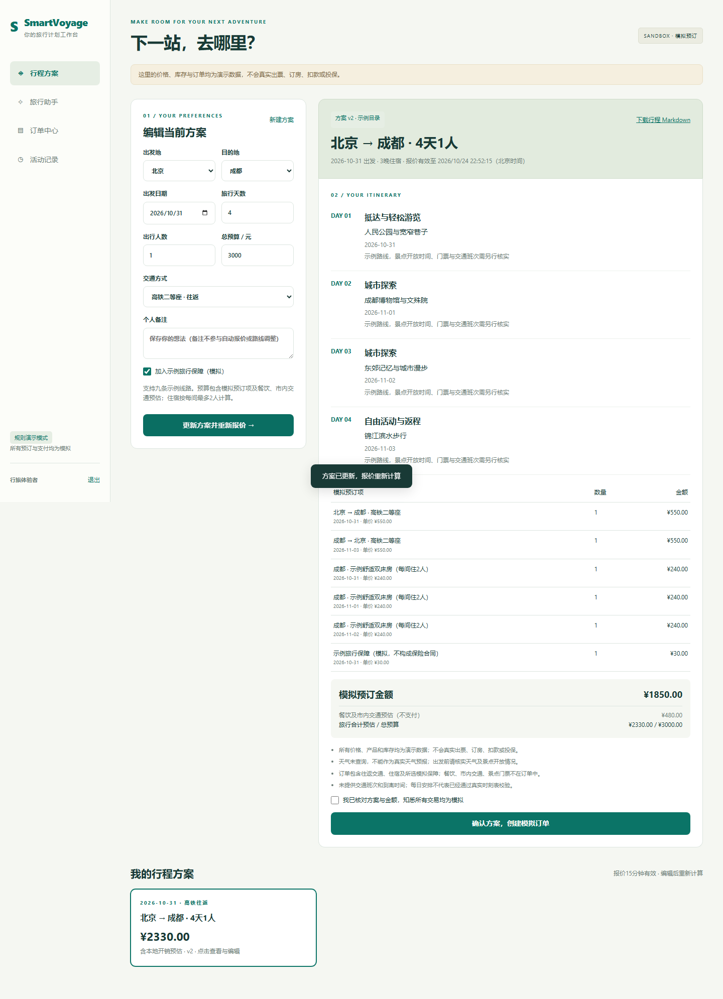
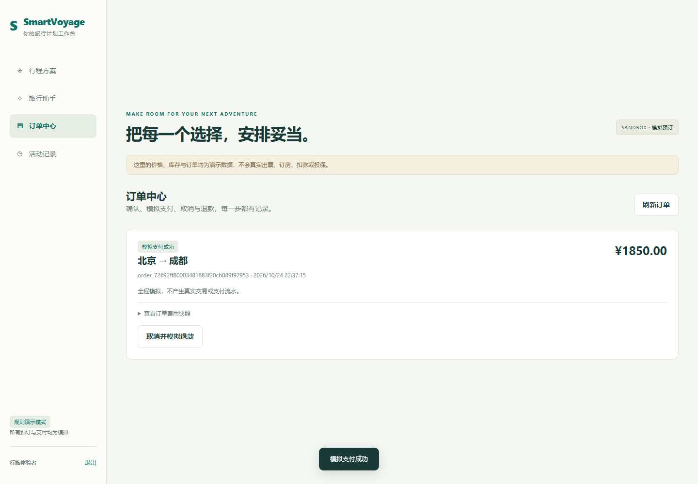

# SmartVoyage · 旅行规划与模拟预订

用户可以注册登录，创建独立会话，生成与修改旅行方案，核对费用后创建模拟订单，完成模拟支付、取消和退款，并查看历史执行记录。

本项目从已有的 SmartVoyage 多智能体代码继续完善。新增产品流程与工程治理，保留原有 LangGraph、A2A、MCP、MySQL 与 Milvus 能力。**默认演示模式不调用大模型；联网模式才使用原有多智能体链路。**

页面预览（临时演示账号与模拟数据）：





## 1. 先运行起来

要求 Python 3.11 或更新版本。无需 MySQL、Docker、Milvus 或模型密钥即可运行演示模式。

首次从 GitHub 获取项目时，在你准备存放项目的目录执行（保留下面的本地目录名，供 Python 包导入使用）：

```powershell
git clone https://github.com/aejqlejql/smartvoyage.git ai01_SmartVoyage
```

以下 Python 命令在 `ai01_SmartVoyage` 的父目录执行；本机已有项目对应父目录 `04-代码`：

```powershell
python -m pip install -r ai01_SmartVoyage/requirements-demo.txt
python -m ai01_SmartVoyage.scripts.launch
```

也可以双击项目根目录的 **`启动项目.cmd`**。启动器会打开浏览器，默认地址为 [http://127.0.0.1:8080](http://127.0.0.1:8080)。关闭服务使用终端中的 `Ctrl+C`。已有端口占用时会提示，不会终止其他程序。

首次使用请在页面创建账号，没有预置账号或默认密码。邮箱只作为本地登录标识，不会发送验证邮件，建议使用 `you@example.test` 等演示邮箱。

修改端口后运行：

```powershell
$env:SMARTVOYAGE_API_PORT="8088"
python -m ai01_SmartVoyage.scripts.launch
```

如果希望使用独立虚拟环境，可以在安装依赖前运行：

```powershell
python -m venv ai01_SmartVoyage/.venv
ai01_SmartVoyage/.venv/Scripts/python.exe -m pip install -r ai01_SmartVoyage/requirements-demo.txt
```

双击启动器优先使用项目内 `.venv`。不要把已有 `.env`、`data/`、`logs/` 上传到代码仓库。

## 2. 完整演示流程

1. 注册账号，进入「行程方案」。
2. 使用默认的北京至成都、3天1人、3000元预算，生成方案。
3. 查看每日安排、往返交通、住宿、模拟保障和费用明细。
4. 修改天数、人数、预算或交通，更新方案。版本号递增，报价重新计算。
5. 勾选说明，确认创建模拟订单。
6. 在「订单中心」确认金额并模拟支付，然后取消并模拟退款。
7. 进入「旅行助手」，询问方案费用，创建另一个会话并切换查看。
8. 在会话中查看执行记录，在「活动记录」查看订单和咨询历史。
9. 下载行程 Markdown，刷新页面确认账号与行程仍在。

默认三天一人示例：往返高铁1100元、两晚住宿480元、模拟保障30元，预订合计1610元；另预估餐饮及市内交通360元，旅行总预估1970元。**这只是程序验收数据，不是真实市场报价。**

## 3. 当前已实现的范围

| 模块 | 实际能力 |
|---|---|
| 账号 | 注册、登录、退出、密码 scrypt 加盐哈希、可撤销的24小时会话 |
| 访问控制 | HttpOnly / SameSite Cookie、写接口 CSRF、按所有者校验每一个资源 |
| 旅行方案 | 九条示例线路、2至7天、1至6人、往返交通、住宿、可选模拟保障 |
| 报价 | 金额以分保存、预算规则、单价与数量明细、15分钟有效期、版本冲突检测 |
| 模拟订单 | 用户确认、服务端重新报价、库存占用、幂等下单、订单快照 |
| 模拟支付售后 | 确认支付、取消、模拟全额退款、重复操作不重复释放库存 |
| 订单过期 | 每30秒后台清理，读订单及交易操作前再次清理，释放超时库存 |
| 会话 | 用户及会话隔离、持久化消息与偏好、清空当前会话、数据库会话锁 |
| 执行记录 | 每次请求独立 run_id、模式、状态、耗时、历史 Trace 与活动审计 |
| 前端 | 行程工作台、订单中心、会话切换、执行记录、桌面及手机适配 |
| 数据导出 | 行程 Markdown 下载、SQLite 在线备份、排除私密数据的源码打包 |
| 工程 | 小依赖启动、Docker 配置、接口测试、并发库存测试、浏览器验收 |

备注字段只保存个人说明，不参与自动报价或路线调整。行程按城市模板生成，不是求解真实班次或景点时刻约束的排程器。

## 4. 两种运行模式

| 模式 | 旅行助手 | 方案与订单 |
|---|---|---|
| `demo`（默认） | 确定性规则，引用当前账号最近保存的方案，明确标记未调用 LLM | 本地示例目录 + SQLite 模拟交易 |
| `live` | 原有 ChatService → LangGraph → A2A 专家 → MCP 工具 | 仍为独立的示例目录 + SQLite 模拟交易 |

联网 Agent 查询得到的自由文本不会直接转为订单。已有聊天预订工具现在返回“需要在方案页确认/当前不支持”，不会只凭一句话伪造下单成功。租车、旅游团、演唱会可以作为原有查询能力继续开发，但未纳入本版可预订订单范围。

启用联网模式前，安装完整依赖并配置模型与供应商演示数据库：

```powershell
python -m pip install -r ai01_SmartVoyage/requirements.txt
if (-not (Test-Path ai01_SmartVoyage/.env)) { Copy-Item ai01_SmartVoyage/config.example.env ai01_SmartVoyage/.env }
# 编辑 .env 填入你自己的模型和数据库配置。已有 .env 时保留原文件，不要覆盖。
$env:SMARTVOYAGE_MODE="live"
python -m ai01_SmartVoyage.scripts.start_all
```

MySQL 演示数据初始化、Milvus 的可选初始化仍使用 `scripts/init_demo_data.py`。`--reset-db` 会重建 `travel_rag` 数据库，只能指向你专门创建的演示库。默认模式完全不需要执行该命令。

每次联网请求创建独立 `ChatService(persistent_memory=False)`，只注入当前会话的 SQLite 记忆，不再读写旧版全局 MySQL 记忆表。同步 LLM 调用放在线程中，HTTP 等待上限100秒；底层单次模型调用设置25秒超时及最多一次重试。超时不会自动切换到规则模式。

## 5. 结构与数据

```text
static/                    原生 HTML / CSS / JavaScript，无前端构建依赖
api/server.py              认证依赖、输入校验、错误响应与 HTTP 接口
product/auth.py            密码哈希与登录会话
product/planning.py        旅行输入、示例供应商目录、费用和预算规则
product/booking.py         报价版本、事务库存、幂等下单、订单状态机
product/chat.py            模式适配、会话隔离、历史运行记录
product/store.py           SQLite 建表、所有者校验、审计、会话锁、限流
product/export.py          行程 Markdown
app/chat/ + core/ + agents/ 原有多智能体工作流与专家注册
a2a_server/ + mcp_server/   原有专家与工具进程
tests/                     业务验收、工作流和工具测试
docs/                      项目讲解、接口、运维与验收说明
```

**SQLite** 保存账号、登录会话、对话、运行记录、方案、订单、库存和审计。默认位置是项目内 `data/smartvoyage.sqlite3`。重启不丢数据；不会自动迁移旧版共用记忆。

**MySQL** 仅作为原有联网工具的演示业务数据源；**Milvus** 用于可选旅游团检索。它们与应用账号和订单库分开，避免把供应商测试库误当用户交易库。

SQLite 使用 WAL 和 `BEGIN IMMEDIATE`。库存按产品和使用日期分开，预订中的条件更新与订单创建处于同一个事务。适合本机或单机部署的个人项目；多主机部署前需要迁移应用存储与锁机制。

## 6. 验证与浏览器验收

```powershell
python -m pip install -r ai01_SmartVoyage/requirements-dev.txt
python -m ai01_SmartVoyage.scripts.verify
python -m playwright install chromium
python -m ai01_SmartVoyage.scripts.browser_acceptance
```

完整旧版测试还需要 `requirements.txt` 的依赖。只安装轻量开发依赖时，可以先运行 `test_product.py`；`verify.py` 提供 `--product-only` 模式。

浏览器验收启动独立临时数据库与随机端口，不改你的账号和订单。截图与报告写入 `artifacts/browser/`。`verify.py` 避开本机系统 Temp 权限问题，将测试临时文件放在项目内 `.test-runs/`。

在线 MySQL 与 A2A 集成测试默认跳过，分别设置 `RUN_DB_INTEGRATION_TESTS=1`、`RUN_A2A_INTEGRATION_TESTS=1` 后才能进行。不能把跳过当成在线链路已验证。

## 7. Docker

在项目目录执行轻量演示部署：

```powershell
docker compose -f docker-compose.demo.yml up --build -d
```

联网多进程部署保留 `docker-compose.yml`。它显式设置 `SMARTVOYAGE_MODE=live`，并为应用数据库增加独立持久卷。

停止服务可使用相应 Compose 文件的 `down`。**不要加 `-v`，除非你明确要删除持久化数据。** 本次容器配置是否已实测，以 [验收记录](docs/验收记录.md) 为准。

## 8. 备份与分享

```powershell
python -m ai01_SmartVoyage.scripts.backup_data
python -m ai01_SmartVoyage.scripts.package_project
```

前者使用 SQLite 在线备份 API，输出到应用数据库旁的 `backups/`，包含私密账号、登录会话和订单，自己保存。后者输出 `artifacts/SmartVoyage-personal-project.zip`，不含 `.env`、运行数据库、日志或浏览器测试数据，适合代码分享。
