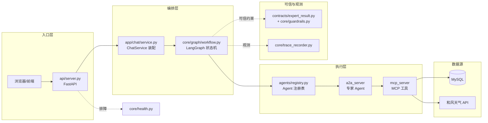
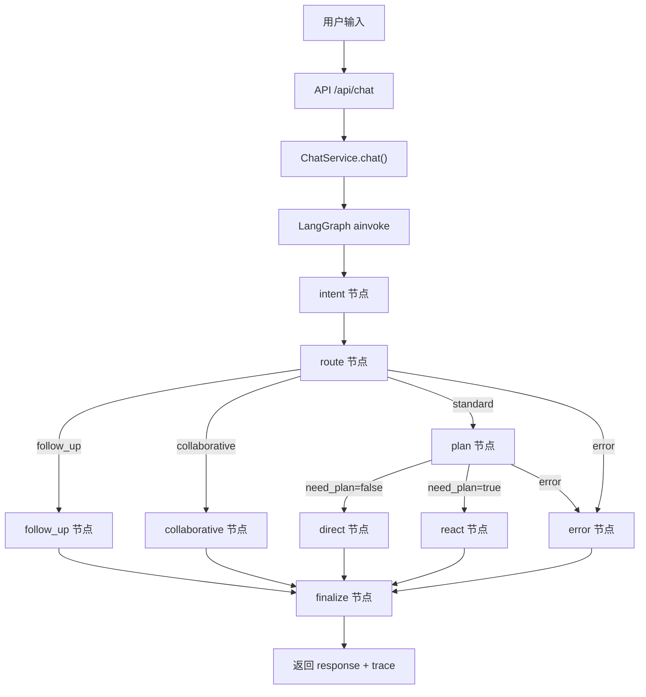
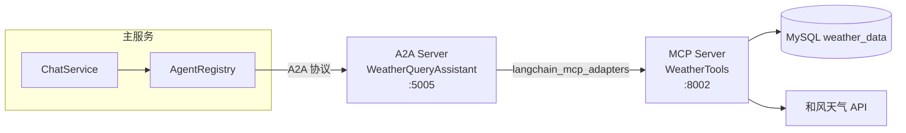
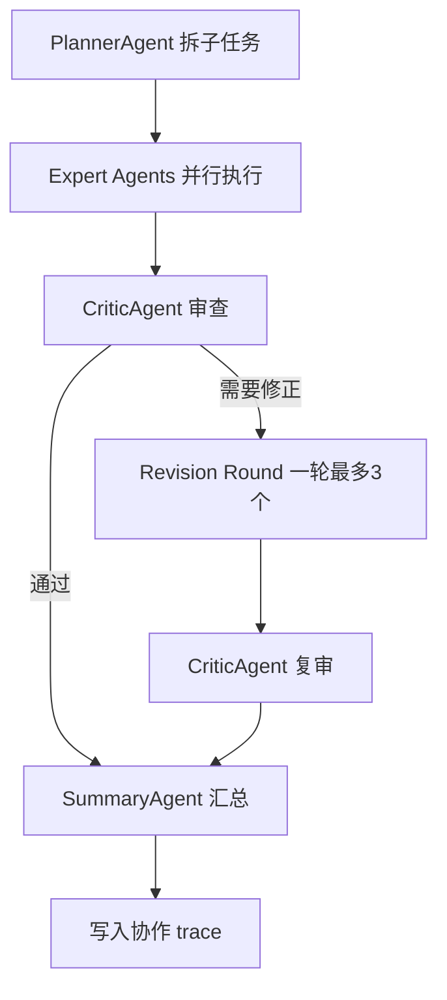
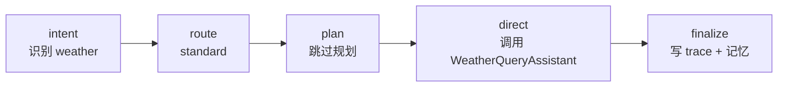
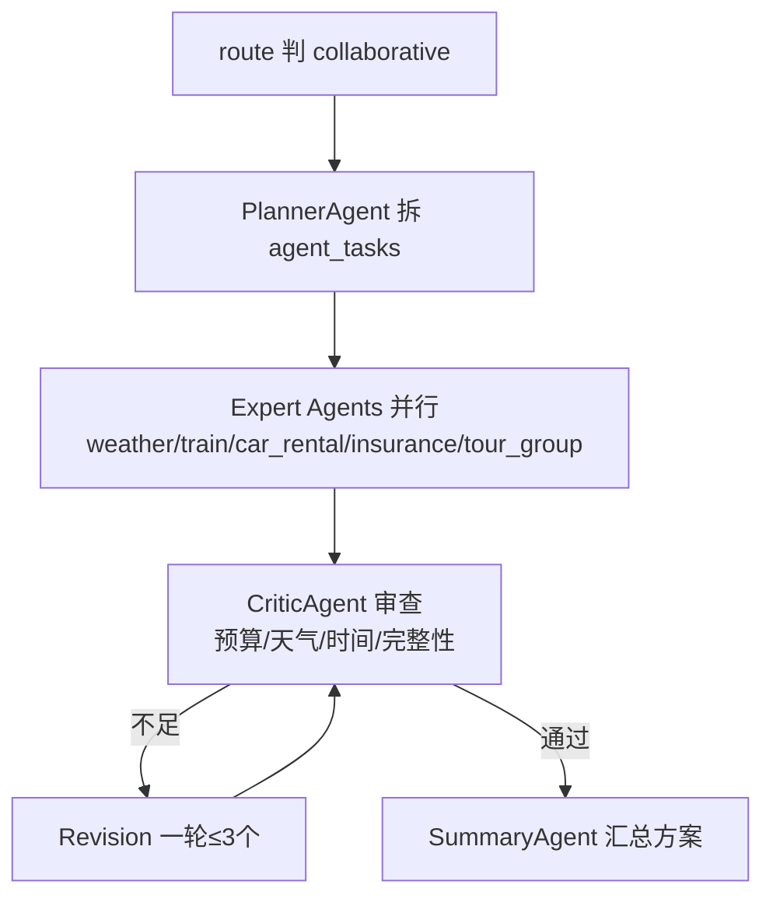

# SmartVoyage 项目授课讲义 —— 一条旅行业务请求的完整旅程

> 历史 Agent 层讲义。新版入口已增加用户认证、会话隔离、方案和模拟订单；实际产品流程以 [README](../README.md) 与 [个人项目讲解](个人项目讲解.md) 为准。

> 主讲路线：**「一条用户请求怎么跑完」**，而不是从文件树开始。
> 配套：本讲义是「主讲义」，[student-handoff-flow.md](./student-handoff-flow.md) 是给学生传阅的交接说明，[code-walkthrough.md](./code-walkthrough.md) 是代码导航索引。

---

## 0. 一句话总纲（开场先立靶子）

这个项目**不是一个「会聊天的模型」**，而是一个：

> `API 入口 + LangGraph 编排 + A2A 专家 Agent + MCP 工具层 + 数据源 + 可信输出约束`

同学们，先记住这一句话。后面每一层代码，都是在为这句话里的某一块「填空」。

| 抽象名词 | 具体落点 | 职责 |
| --- | --- | --- |
| API 入口 | `api/server.py` | 收 HTTP 请求、返回结果 |
| LangGraph 编排 | `core/graph/workflow.py` + `core/graph/state.py` | 决定「流程怎么走」 |
| A2A 专家 Agent | `agents/registry.py` + `a2a_server/*.py` | 决定「找哪个专家」 |
| MCP 工具层 | `mcp_server/*.py` | 决定「真实数据从哪来」 |
| 可信输出约束 | `contracts/expert_result.py` + `core/guardrails.py` | 决定「什么能答、什么不能编」 |
| 观测 | `core/trace_recorder.py` + `core/health.py` | 决定「前端怎么看链路、部署怎么排障」 |

---

## 1. 先讲业务问题，不讲代码（约 3 分钟）

在打开任何一个 `.py` 之前，先让学生明白：**用户问的是旅行问题，系统要做的不是「生成作文」，而是「查数据、做判断、出方案」。**

用一个反例引导思考：

- 如果用户问「成都 5 月 1 日天气怎么样」，一个只会「生成」的模型可能直接编一段「多云转晴，28 度」。
- 但这个项目要回答的是：**数据库里那天到底有没有记录**。有，就返回真实温度；没有，就说「暂无数据」。

所以系统的主线是：

```text
理解用户想要什么（意图） → 判断复杂度（路由） → 找到能干的专家（A2A）
→ 让专家查真实数据（MCP） → 拿到结果判断能不能答（可信约束） → 汇总返回
```

这一段只要让学生建立「**可信查询 > 文本生成**」的心智模型，代码就顺理成章了。

---

## 2. 总架构（一张图讲完，约 5 分钟）



**这一页必须强调的一句话：**

> `LangGraph` 是主流程大脑，`ChatService` 只是装配层。

很多同学一开始会以为 `ChatService` 是核心。不是的——它只负责把 LLM、Memory、AgentRegistry、CollaborationEngine、LangGraph **组装起来**，真正的「这一条请求走哪条路」是由 `SmartVoyageWorkflowGraph`（LangGraph）决定的。

---

## 3. 一条请求怎么跑完（全课最重要的一段，约 8 分钟）

先看精确的流转图（**注意：比直觉多一层 `plan` 节点**，这是源码真实结构）：



**关键讲点（这是源码精确事实，务必讲清）：**

1. `route` 节点只有 4 个出口：`follow_up` / `collaborative` / `standard` / `error`（见 `workflow.py` 的 `_route_key`）。
2. `standard` 不是直接执行，而是先进 `plan` 节点，再由 `plan` 节点分流成 `direct` 或 `react`（见 `_plan_key`）。
3. 所有叶子节点（`follow_up` / `direct` / `react` / `collaborative` / `error`）都汇入同一个 `finalize` 节点，最后统一收口写 trace 和记忆。

对应的源码（`core/graph/workflow.py:329-370`）：

```python
def _build_graph(self):
    builder = StateGraph(SmartVoyageState)
    # 9 个节点
    builder.add_node("intent", self._intent_node)
    builder.add_node("route", self._route_node)
    builder.add_node("plan", self._plan_node)
    builder.add_node("direct", self._direct_node)
    builder.add_node("react", self._react_node)
    builder.add_node("collaborative", self._collaborative_node)
    builder.add_node("follow_up", self._follow_up_node)
    builder.add_node("error", self._error_node)
    builder.add_node("finalize", self._finalize_node)

    builder.add_edge(START, "intent")
    builder.add_edge("intent", "route")
    # 条件边 1：route → 4 选 1
    builder.add_conditional_edges("route", self._route_key, {
        "follow_up": "follow_up",
        "collaborative": "collaborative",
        "standard": "plan",
        "error": "error",
    })
    # 条件边 2：plan → 3 选 1
    builder.add_conditional_edges("plan", self._plan_key, {
        "direct": "direct",
        "react": "react",
        "error": "error",
    })
    # 所有叶子都汇入 finalize
    for node_name in ("follow_up", "direct", "react", "collaborative", "error"):
        builder.add_edge(node_name, "finalize")
    builder.add_edge("finalize", END)
    return builder.compile()
```

告诉学生：**这就是项目的大脑。** 以前用一堆 `if/else` 写流程，现在用 LangGraph 把流程「画成图」，节点职责清晰、条件边表达分支、`compile()` 一次性编译。

---

## 4. 逐层代码讲解（约 18 分钟）

### 4.1 `api/server.py` —— 只讲 HTTP 和返回（2 分钟）

打开 `api/server.py`，只讲这一个函数：

```python
# api/server.py:62-72
@app.post("/api/chat")
async def chat(request: ChatRequest):
    service = get_chat_service()          # 拿到单例
    response = await service.chat(request.message)   # 交给 ChatService
    return {
        "status": "success",
        "message": response,
        "trace": service.get_collaboration_trace(),  # 顺手把 trace 也返回
    }
```

这一层只讲三件事：

```text
1. 接收请求   —— ChatRequest 里只有一个 message 字段
2. 调用 ChatService —— 不在这里做任何业务判断
3. 返回 response + trace —— trace 是给前端右侧面板用的
```

**强调**：`get_chat_service()`（`server.py:21-27`）是**延迟单例**——第一次请求才真正实例化 `ChatService`，避免 API 进程一 import 就加载大模型、连 MySQL。这是工程上很实用的一个细节。

顺带点一下配套路由（不用展开）：
- `/api/chat/stream`（`server.py:84-88`）→ SSE 流式
- `/api/collaboration/trace`（`server.py:117-123`）→ 前端读轨迹
- `/api/health/dependencies`（`server.py:54-59`）→ 依赖探活

### 4.2 `app/chat/service.py` —— 讲「装配」，不是讲「状态机」（3 分钟）

重点讲 `ChatService.__init__()`（`service.py:207` 起）。核心一句话：

> `ChatService` 不负责决定流程怎么走；它负责把 LLM、Memory、AgentRegistry、CollaborationEngine、LangGraph **装起来**。

带学生看这几个成员（`service.py:221-266`）：

```python
self.agent_registry = AgentRegistry()                    # A2A 专家注册表
self.llm = ChatOpenAI(model=..., temperature=0.1)        # 大模型
self.memory = ConversationMemory(short_term_limit=10)    # 短期记忆
self.trace_recorder = TraceRecorder()                    # 轨迹记录
self.collaboration_engine = CollaborationEngine(
    llm=self.llm, memory=self.memory,
    call_agent_intent=self._call_agent_intent,           # 复用 A2A 调用
    trace_recorder=self.trace_recorder, intent_map=conf.intent,
)
self.workflow_graph = SmartVoyageWorkflowGraph(
    intent_agent=self.intent_agent,
    should_use_collaborative_planning=self._should_use_collaborative_planning,
    collaborative_plan=self.collaborative_plan,
    should_skip_planning=self._should_skip_planning,
    planning_agent=self.planning_agent,
    react_loop=self.react_loop,
    call_agent_intent=self._call_agent_intent,
    record_user_message=self._record_user_message,
    record_assistant_message=self._record_assistant_message,
    record_error_message=self._record_error_message,
    trace_recorder=self.trace_recorder, intent_map=conf.intent,
)
```

**两个关键设计点，务必讲：**

1. **依赖注入 / 回调解耦**：`SmartVoyageWorkflowGraph` 需要的业务能力（意图识别、规划、A2A 调用、记忆写入）全部是通过构造函数**传函数引用**进去的。LangGraph 只负责「调度」，具体能力还在 `ChatService` 手里。这就是「编排层 vs 装配层」分离的本质。

2. **`chat()` 只有一行**（`service.py:842-849`）：

```python
async def chat(self, user_input: str) -> str:
    return await self.workflow_graph.chat(user_input)
```

`ChatService.chat()` 把自己「让位」给了 LangGraph。这一段总结成一句话：

> ChatService 是「能力装配中心」，不是「流程大脑」。

### 4.3 `core/graph/state.py` —— 一次请求的状态数据长什么样（2 分钟）

打开 `state.py`，讲 `SmartVoyageState`（`state.py:12-38`）。核心认知：

> LangGraph 每个节点之间**不是随便传变量**，而是共享一个**状态对象**。每个节点读一部分、返回一部分更新，LangGraph 负责合并。

重点字段分组讲：

| 字段组 | 字段 | 含义 |
| --- | --- | --- |
| 输入/元信息 | `user_input` / `run_id` / `created_at` | 原始输入 + 本次运行标识 |
| 流转状态 | `status` / `mode` / `route` / `plan_route` | 当前走到哪一步、选了哪条路 |
| 意图与规划 | `intents` / `user_queries` / `follow_up_message` / `plan` | 意图识别 + 改写查询 + 计划 |
| 执行结果 | `execution_trace` / `response` / `collaboration_used` | 执行轨迹 + 最终回复 |
| 错误收口 | `error_message` | 统一的错误信息 |

它本质是一个 `TypedDict`：

```python
class SmartVoyageState(TypedDict, total=False):
    user_input: str
    run_id: str
    created_at: str
    status: str
    mode: str
    route: str
    plan_route: str
    intents: list[str]
    user_queries: dict[str, Any]
    follow_up_message: str
    plan: dict[str, Any]
    execution_trace: list[dict[str, Any]]
    response: str
    collaboration_used: bool
    error_message: str
```

这一步学生理解后，后面讲 LangGraph 会轻松很多——**节点函数签名都是 `(state) -> dict`，返回的就是要写回 state 的那几个字段的增量。**

### 4.4 `core/graph/workflow.py` —— 节点、条件边、路由（4 分钟）

先讲 `_build_graph()`（已在第 3 节讲图），再按节点讲每个节点的「一句话职责」：

| 节点 | 方法 | 一句话职责 |
| --- | --- | --- |
| intent | `_intent_node` (105) | 调 `intent_agent`，产出 `intents/user_queries/follow_up_message` |
| route | `_route_node` (120) | 判断走 `follow_up/collaborative/standard/error` |
| plan | `_plan_node` (153) | 判断 `direct` 还是 `react` |
| direct | `_direct_node` (177) | 逐个意图调 `call_agent_intent`，拼接结果 |
| react | `_react_node` (205) | 按计划步骤跑 `react_loop` 并汇总 |
| collaborative | `_collaborative_node` (235) | 委托 `collaboration_engine.plan` |
| follow_up | `_follow_up_node` (260) | 信息不足直接返回追问 |
| error | `_error_node` (270) | 统一生成错误回复 |
| finalize | `_finalize_node` (278) | 写 trace + 写记忆，收口 |

重点带学生读 **`_route_node` 的判定顺序**（`workflow.py:120-151`）：

```python
if state.get("error_message"):                 # 1. 前面已经出错 → error
    route = "error"
elif ("out_of_scope" in intents or follow_up): # 2. 越界/要追问 → follow_up
    route = "follow_up"
elif self.should_use_collaborative_planning(...): # 3. 综合方案 → collaborative
    route = "collaborative"
else:                                          # 4. 普通请求 → standard
    route = "standard"
```

以及 **`_finalize_node` 的收口逻辑**（`workflow.py:278-315`）：

```python
if is_error:
    self.trace_recorder.record_error(...)       # 错误走 record_error
    self.record_error_message(response)
else:
    if not state.get("collaboration_used"):
        self.trace_recorder.record_standard(...) # 普通链路这里写 trace
    self.record_assistant_message(response)      # 记忆写入
```

一个容易漏的点：**协作链路的 trace 不在这里写**——它在 `collaboration_engine.plan()` 内部就已经写好了（见 4.10），`finalize` 只负责补记忆。

### 4.5 `agents/registry.py` —— 主服务如何找到专家 Agent（2 分钟）

打开 `registry.py`，讲三件事：

1. **URL 表**（`registry.py:26-36`）：把专家名字映射到 A2A 地址，且全部可用环境变量覆盖：

```python
self.agent_urls = {
    "WeatherQueryAssistant": os.getenv("WEATHER_A2A_URL", "http://127.0.0.1:5005"),
    "TicketAssistant":      os.getenv("TICKET_A2A_URL", "http://127.0.0.1:5006"),
    "TripAssistant":        os.getenv("TRIP_A2A_URL",   "http://127.0.0.1:5007"),
}
```

2. **注册到 AgentNetwork**（`registry.py:37-43`）：`A2AClient(agent_url, timeout=120)` —— 注意 120s 超时，因为 A2A 内部还要串 LLM + MCP，链路较长。

3. **对外三个统一接口**：
   - `get_agent(name)` → 拿客户端（`service.py` 调用它发任务）
   - `get_agent_cards()` → 给前端 `/api/agents` 展示
   - `get_available_tools()` → 把 Agent Card 转成 prompt 可读文本，喂给规划/ReAct

**强调**：`AgentRegistry` 只回答「有哪些专家、在哪、能干什么」，**业务查询不在这里执行**。这是「路由层」与「执行层」的清晰边界。

配合讲意图映射（`infrastructure/config.py:84-94`）：

```python
self.intent = {
    "weather": "WeatherQueryAssistant",
    "flight": "TicketAssistant",
    "train": "TicketAssistant",
    "concert": "TicketAssistant",
    "order": "TicketAssistant",
    "car_rental": "TripAssistant",
    "tour_group": "TripAssistant",
    "insurance": "TripAssistant",
    "trip_order": "TripAssistant",
}
```

两个观察点：
- `attraction`（景点）**不在表里**——它不走 A2A，直接由 LLM 生成（见 4.6）。
- 三个专家各管一类：天气、票务、行程（租车/旅游团/保险）。

### 4.6 `app/chat/service.py` 的 `_call_agent_intent()` —— 真正调用专家的地方（3 分钟）

回到 `service.py`，讲 `_call_agent_intent`（`service.py:603-722`）。这是**统一 Agent 调用底层**，`direct` 路径和 `react` 路径都复用它。

内部三分支（对应 `service.py:634-722`）：

```text
intent == attraction        → 直接 LLM 生成（先查目的地天气，保证推荐基于真实天气）
conf.intent 里有对应 Agent  → 走 A2A：send_task → 解析 ExpertResult → 按类型总结
都没有                      → "暂不支持此意图。"
```

**A2A 调用段**（`service.py:648-718`）的核心链路：

```python
agent = self.agent_registry.get_agent(agent_name)   # 1. 从注册表拿客户端
# 2. 结构化组装 agent 输入（历史 + 查询 + 当前日期 + guardrail 提示）
agent_input = json.dumps({
    "history": ..., "query": query_str,
    "current_date": self._today(),
    "guardrail": "历史只用于补全上下文；日期判断以 current_date 和当前 query 为准...",
}, ensure_ascii=False)
task = Task(id="task-"+str(uuid.uuid4()), message=msg.to_dict())
raw_response = await asyncio.get_event_loop().run_in_executor(...)  # 3. 发 A2A 任务
# 4. 读 artifact → 解析成 ExpertResult
expert_result = self._parse_expert_result(agent_name, agent_result)
# 5. 成功才总结，unavailable 直接走保守兜底
if expert_result.unavailable:
    return self._fallback_service_reply(agent_name, expert_result.to_json())
return chain.invoke({"query": ..., "raw_response": expert_result.summary_input(), ...})
```

**这里必须强调的一个点**：注意 `agent_input` 里那段 `guardrail` 字段——主服务在把请求发给专家时，就已经带上了「日期以 current_date 为准、业务结论只能来自工具结果」的约束。这是「可信」在**上游**就埋下的一道防线，而不只是下游兜底。

### 4.7 A2A + MCP —— 两层协议的职责边界（4 分钟）

先给一张「谁在调谁」的图：



**A2A 服务端**（`a2a_server/weather_server.py`）重点讲 `handle_task`（`weather_server.py:113-154`）：

```python
def handle_task(self, task):
    content = (task.message or {}).get("content", {})
    conversation = content.get("text", "")
    if not conversation:                       # 缺参数 → input_required
        task.artifacts = text_artifact(ExpertResult.input_required(...).to_json())
        task.status = TaskStatus(state=TaskState.INPUT_REQUIRED)
        return task
    result = asyncio.run(query_weather(conversation))   # 调 MCP
    expert_result = ExpertResult.from_text(result, agent=..., source="mcp")
    task.artifacts = text_artifact(expert_result.to_json())
    ...
```

再看 `query_weather`（`weather_server.py:80-99`）——它用 `langchain_mcp_adapters.MultiServerMCPClient` 连到 MCP，然后让一个**受约束的 LangChain Agent** 去查：

```python
mcp_client = MultiServerMCPClient({
    "weather": {"url": f"{MCP_URL}/mcp", "transport": "streamable_http"}
})
tools = await mcp_client.get_tools(server_name="weather")
agent = create_agent(model=llm, tools=tools, system_prompt=system_prompt)
```

**system_prompt 是重点**（`weather_server.py:85-93`），它把「可信规则」写死了：

```text
- 缺少必要信息时直接向用户追问，不要编造天气数据。
- 工具返回 status=no_data → 只能说"没有该城市/日期的记录"，不能说服务不可用。
- 工具返回 status=error/database_unavailable → 才能说数据源不可用。
- 无论哪种失败，禁止补写预计温度、湿度、风向、降水概率等数值。
- 最终只输出 JSON，status 只能是 success/no_data/error/input_required。
```

**MCP 服务端**（`mcp_server/mcp_weather_server.py`）——这里才是真正碰数据的地方。重点讲 `WeatherService.query_weather`（`mcp_weather_server.py:134-185`）：

```python
sql = ("SELECT city, fx_date, temp_max, temp_min, text_day, ... "
       "FROM weather_data "
       "WHERE city = %s AND fx_date BETWEEN %s AND %s ORDER BY fx_date")
cursor.execute(sql, [city, start_date, end_date])   # 参数化，防 SQL 注入
...
if results:
    return json.dumps({"status": "success", "data": results}, ...)
return json.dumps({"status": "no_data", "message": "未找到天气数据，请确认城市和日期。"}, ...)
```

两个工程细节值得点：
1. **参数化查询**（`%s` 占位）——防止 SQL 注入，这是可信系统的数据层底线。
2. **明确的 status 语义**——`success` / `no_data` / `error` 从这里就开始区分，这是后面 `ExpertResult` 能收敛的基础。

**这一段必须反复强调的一句话：**

> A2A 是 **Agent 通信层**（谁找谁、怎么把任务和结果在 Agent 之间传递），MCP 是 **工具调用层**（怎么把「查数据」这件事标准化成工具）。两者各管一件事，不要混。

### 4.8 `contracts/expert_result.py` + `core/guardrails.py` —— 可信输出（4 分钟，全课价值最高）

**先讲 `ExpertResult`**（`expert_result.py`）。一句话：

> 专家 Agent 返回的文本格式五花八门，如果不收敛，SummaryAgent 会在「无数据」时继续编价格、在「故障」时也当正常结果总结。所以用 `ExpertResult` 把一切文本收敛成 **4 种 status**：

| status | 含义 | 能不能引用具体数据 |
| --- | --- | --- |
| `success` | 有真实数据 | ✅ 可以正常总结 |
| `no_data` | 查询有效但无记录 | ❌ 只能说「暂无数据」 |
| `error` | 数据库/网络/服务故障 | ❌ 只能说「数据源不可用」 |
| `input_required` | 缺少必要参数 | ❌ 只能追问补充 |

关键代码：
- 合法状态集合 `VALID_STATUSES`（`expert_result.py:39`）
- `__post_init__` 兜底纠正非法状态（`:56-65`）——任何地方构造出非法 status 都自动变成 `error`，下游永远拿到合法状态。
- `unavailable` 属性（`:67-74`）——只要不是 `success` 就是「不可用」。
- `from_text`（`:186-267`）——把 A2A/MCP 的原始文本自动解析成统一结构：先试 JSON，再退回关键词信号判断。

**再讲 `guardrails.py`**——它提供两组「确定性」规则（纯正则 + 字符串匹配，不依赖 LLM，可单测）：

1. **日期标准化**：`normalize_yearless_dates`（`guardrails.py:91-119`）把「5 月 1 日」补成 `2026-05-01`（`_YEARLESS_MONTH_DAY_RE`，`:38-40`），供数据库按绝对日期查。
2. **信号识别**：
   - `contains_explicit_no_data_signal`（`:176`）→ 识别「未找到 / 暂无数据 / 没有天气记录」等 `_NO_DATA_MARKERS`（`:44-53`）
   - `contains_data_source_error`（`:189`）→ 识别「数据库连接失败 / 服务暂时不可用」等 `_DATA_SOURCE_ERROR_MARKERS`（`:57-71`）
   - `all_results_unavailable`（`:204-241`）→ 判断协作链里是不是「所有专家都不可用」

**为什么要区分 `no_data` 和 `error`？** 这是最容易讲出价值的地方：

| | 无数据（no_data） | 故障（error） |
| --- | --- | --- |
| 语义 | 查询有效，结果为空 | 数据库/网络坏了 |
| 对用户 | 「暂无该日期记录，请确认城市/日期」 | 「数据源暂时不可用，请稍后重试」 |
| 能否重试 | 无需重试，改条件即可 | 稍后重试可能恢复 |

对应 `service.py` 的 `_fallback_service_reply`（`:318-348`）就是按这个区分给不同兜底话术的。

**收口一句，务必让每个学生记住：**

> 可信智能体不是「回答得像真的」，而是「知道什么时候不能回答」。

### 4.9 `core/collaboration_engine.py` —— Planner / Expert / Critic / Summary 协作链（3 分钟）

打开 `collaboration_engine.py`，这是**强多智能体协作**的落点，只在「综合旅行方案」场景启用。

链路（`plan()`，`collaboration_engine.py:333-387`）：



对应方法：

| 方法 | 行号 | 职责 |
| --- | --- | --- |
| `_build_plan` | 173 | PlannerAgent 用 LLM 拆 `agent_tasks` |
| `_normalize_plan` | 105 | 校验计划、别名映射、去重、兜底报错 |
| `_execute_task` | 203 | 调 `call_agent_intent` 执行一个子任务 |
| `_review` | 237 | CriticAgent 输出结构化审查 |
| `_run_revision_tasks` | 263 | 最多 3 个修正任务，只跑一轮 |
| `_summarize` | 308 | SummaryAgent 汇总最终方案 |
| `plan` | 333 | 串起整条链，`asyncio.gather` 并行执行 |

三个必须讲的设计点：

1. **并行执行**（`collaboration_engine.py:346-349`）：`asyncio.gather(..., return_exceptions=True)` —— 多个专家同时查，单个失败不中断整条链，失败信息进 Critic/Summary 由最终答案解释缺失项。

2. **修正轮有上限**（`collaboration_engine.py:263-291`）：最多取 3 个修正任务、只跑一轮，**防止协作链无限循环**。

3. **汇总前兜底**（`collaboration_engine.py:316-320`）：`all_results_unavailable` 为真时直接返回「无法生成方案」，**不让 SummaryAgent 凭空编方案**——这是可信约束在协作层的再次体现。

### 4.10 `core/trace_recorder.py` —— 前端为什么能看到协作链路（1.5 分钟）

打开 `trace_recorder.py`，核心一句话：

> `TraceRecorder` 只保存**最近一次请求**的结构化轨迹，供 `/api/collaboration/trace` 返回、前端 `Collaboration Trace` 面板渲染。

两个记录方法对应两种链路：

- `record_standard`（`:43-80`）→ 普通 direct/ReAct/追问/error，`planner.agent` 是 `ChatServiceRouter`。
- `record_collaboration`（`:82-119`）→ 协作链路，四段结构正好对应前端四个阶段：

```python
self._trace = {
    "planner":  {"agent": "PlannerAgent", "plan": collaboration_plan},
    "execution": agent_results,          # 每个专家的 round/intent/agent/status/data
    "critic":   {"agent": "CriticAgent", "review": critic_review},
    "summary_agent": {"agent": "SummaryAgent", "summary_preview": summary[:500]},
}
```

**讲清 trace 的两个写入时机**（呼应 4.4）：
- 普通链路：`finalize` 节点里写。
- 协作链路：`collaboration_engine.plan()` 末尾写（因为那时四阶段才齐全）。

当前实现**只在内存**，适合教学演示；要历史 trace，可把 `self._trace` 按 `run_id` 落库（`trace_recorder.py:8-9` 注释已点明）。

### 4.11 `core/health.py` —— 部署排障（1 分钟）

打开 `health.py`，一句话：

> 页面能打开只代表 FastAPI 进程活着，**不代表 MySQL、MCP、A2A 都正常**，所以单独抽一层探活。

`collect_dependency_health`（`health.py:38-84`）依次探测：

| 依赖 | 探测方式 | 必需性 |
| --- | --- | --- |
| mysql | 真实建连再关闭 | 必需 |
| weather/ticket/trip mcp | TCP 端口探活 | 必需 |
| weather/ticket/trip a2a | 读 `/.well-known/agent.json` | 必需 |
| milvus | 检查 collection 是否存在 | 可选（`optional_unavailable`） |

整体 `status` 只有所有**必需**依赖都 `ok` 才是 `ok`，否则 `degraded`。Milvus 挂了不影响必需依赖判定（`health.py:158-189`）。

**课堂可现场演示**：把某个 MCP 停掉，刷新 `/api/health/dependencies`，观察哪一项变红——这是「分布式系统排障」最直观的入口。

---

## 5. 三个必须演示的案例（约 10 分钟）

### 案例 1：简单查询（direct 路径）

输入：`帮我查一下成都5月1日的天气`



逐层带学生走：
1. `intent_agent` 产出 `intents=["weather"]`、`user_queries={"weather": "成都2026-05-01天气"}`。
2. `_should_skip_planning`：单意图 → `need_plan=False` → 走 `direct`。
3. `_direct_node` 遍历意图，调 `_call_agent_intent("weather", ...)`。
4. `conf.intent["weather"]="WeatherQueryAssistant"` → A2A → `handle_task` → MCP `query_weather` → 返回 `{status:success, data:[...]}`。
5. 解析成 `ExpertResult(success)` → 走 `summarize_weather_prompt` 生成自然语言。
6. `finalize` 写 `record_standard` trace + 记忆。

**强调点**：这条路径**省了 planning_agent 那一次 LLM 调用**（`_should_skip_planning` 的启发式优化），响应更快。

### 案例 2：复杂规划（collaborative 路径）

输入：`我想五一从北京去成都玩三天，预算3000以内，帮我规划交通、天气、景点、租车和保险方案`



讲清楚**为什么走协作**（`should_use_collaborative_planning`，`collaboration_engine.py:53-103`）：
- 可执行意图 ≥ 3（交通+天气+保险…），或
- 意图 ≥ 2 且命中「预算/方案/行程/省钱」等强约束词。

这里「预算 3000 以内」就是典型强约束词，会触发 CriticAgent 去检查方案是否超预算。

**强调点**：Planner/Expert/Critic/Summary 是**「角色协作」**，不是一次 LLM 调用；Expert 并行、Critic 把关、Summary 汇总，最终落成一个可执行方案。

### 案例 3：无数据 / 不可用（讲「不能编」）

问学生：如果问「成都 2030 年 1 月 1 日的天气」，数据库没这条记录，系统应该怎么办？

正确链路：
1. MCP 返回 `{status: "no_data", message: "未找到天气数据..."}`。
2. A2A 的 `ExpertResult.from_text` 解析成 `no_data`。
3. 主服务 `_call_agent_intent` 里 `expert_result.unavailable` 为真 → 直接 `_fallback_service_reply` 返回「数据库中暂无该日期天气记录，请确认城市、日期或补充年份」。
4. **全程没有让 LLM 去「补一段天气」**。

再对比「数据源故障」：MySQL 挂了 → MCP 返回 `{status:"error", code:"database_unavailable"}` → 主服务返回「天气数据源暂时不可用，请稍后重试」，也**不编**。

**这一段一定要配合 `ExpertResult` + `guardrails` 讲**，学生才会真正理解什么叫「可信智能体」。可以把三个输出并排展示：

| 场景 | MCP 返回 | ExpertResult | 主服务最终回复 |
| --- | --- | --- | --- |
| 正常 | `success` | `success` | 真实天气总结 |
| 查无记录 | `no_data` | `no_data` | 「暂无该日期记录…」 |
| 服务故障 | `error` | `error` | 「数据源暂时不可用…」 |
| 缺参数 | `input_required` | `input_required` | 追问补充 |

---

## 6. 课堂重点要反复强调的 4 句话

> 1. **`ChatService` 是门面，不是大脑。**（真正的流程推进在 LangGraph）
> 2. **`LangGraph` 负责流程推进，不负责业务数据。**（业务能力通过依赖注入回到 ChatService/A2A/MCP）
> 3. **`A2A` 负责找专家，`MCP` 负责查数据。**（两层协议，各管一件事）
> 4. **没有数据就不能编，必须返回 `no_data`、`error` 或 `input_required`。**（这是可信智能体的底线）

---

## 7. 收尾：四层总结

把整个项目压成四层，作为课程的「收官板书」：

| 层 | 文件 | 一句话 |
| --- | --- | --- |
| 入口层 | `api/server.py` | 接请求、交出去、返回 response + trace |
| 编排层 | `app/chat/service.py` + `core/graph/workflow.py` | 装配能力 + 画流程图推进状态 |
| 执行层 | `agents/registry.py` + `a2a_server/` + `mcp_server/` | 找专家、派任务、查真实数据 |
| 可信与观测层 | `contracts/expert_result.py` + `core/guardrails.py` + `core/trace_recorder.py` + `core/health.py` | 防编造 + 可观测 + 可排障 |

最后用一句话收口整个项目：

> API 负责接请求；ChatService 负责装配能力；LangGraph 负责流程判断；A2A 负责调用专家；MCP 负责查数据；ExpertResult 和 Guardrails 负责防止编造；TraceRecorder 负责展示协作过程。

---

## 附：授课节奏建议

| 阶段 | 内容 | 时长 |
| --- | --- | --- |
| 0-1 | 总纲 + 业务问题 | 3 min |
| 2 | 总架构一张图 | 5 min |
| 3 | 一条请求怎么跑完 | 8 min |
| 4.1-4.6 | 入口 → 装配 → 状态 → 图 → 路由 → 调用专家 | 16 min |
| 4.7 | A2A + MCP 边界 | 4 min |
| 4.8 | 可信输出（ExpertResult + guardrails） | 4 min |
| 4.9-4.11 | 协作引擎 + trace + health | 5 min |
| 5 | 三个演示案例 | 10 min |
| 6-7 | 4 句话 + 四层收尾 | 5 min |
