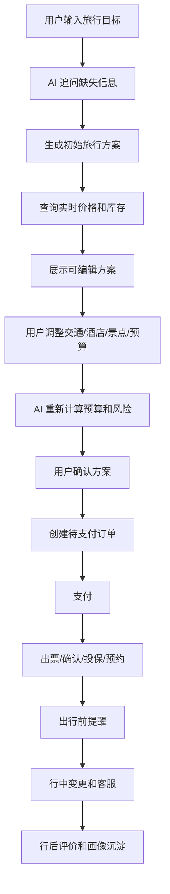
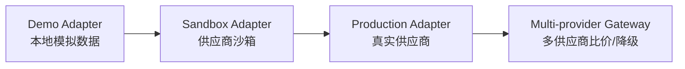
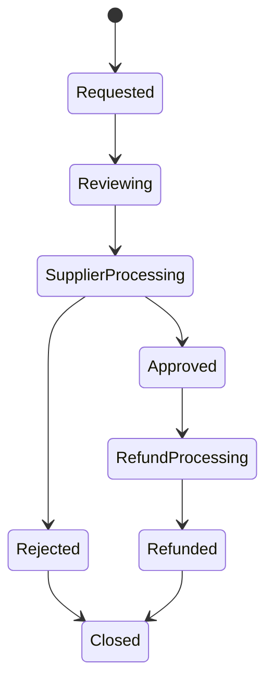
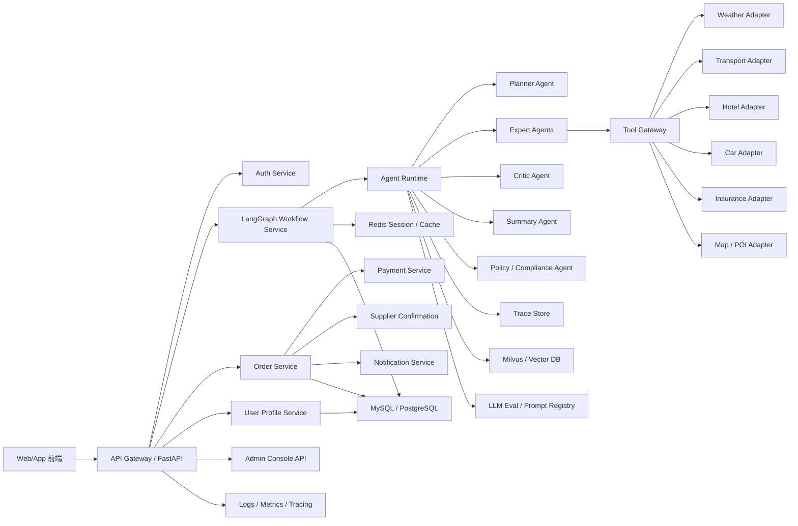
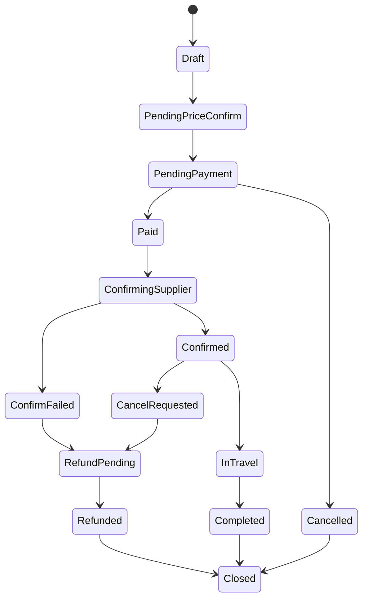
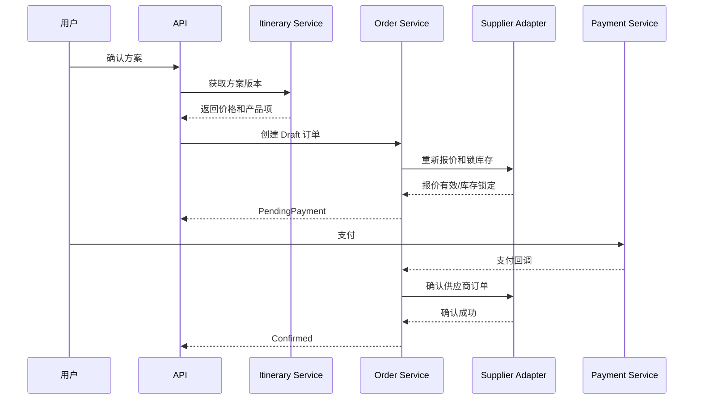
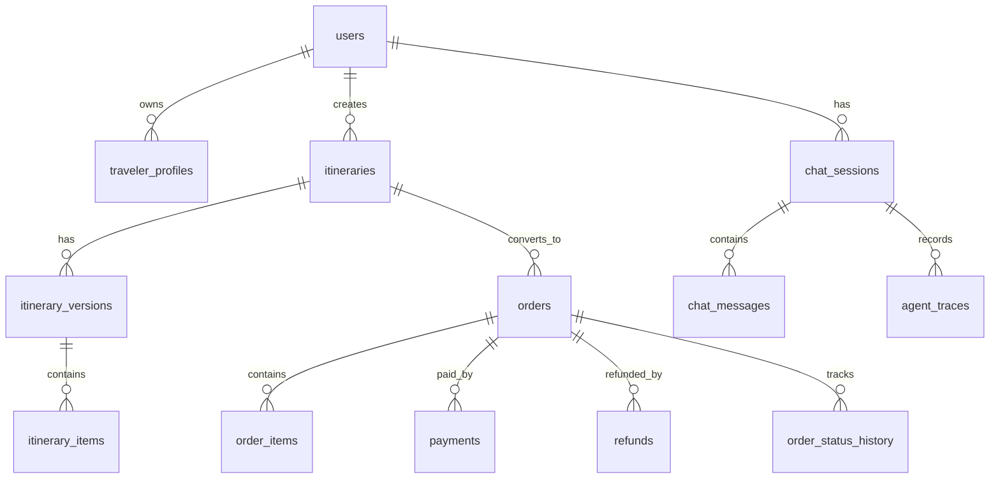

# SmartVoyage 产品级建设完整方案

> 历史规划文档：本版已补齐账号隔离、方案管理与模拟订单闭环。当前实现、验证结果和仍未实现的真实供应商/支付能力，以 [README](../README.md)、[个人项目讲解](个人项目讲解.md) 和 [验收记录](验收记录.md) 为准。本文后续章节仍含未来规划，不能全部视为已实现。

本文面向后续产品化开发团队。目标是让团队拿到本文后，可以继续使用 GPT-6 或其他高级编码 Agent，把当前教学型 SmartVoyage 项目扩展为具备真实业务闭环的产品级旅行智能体系统。

## 1. 目标定位

当前 SmartVoyage 是一个多智能体教学项目，已经具备：

- FastAPI 主服务。
- ChatService / LangGraph 工作流编排层。
- A2A 专家 Agent。
- MCP 工具服务。
- MySQL 演示数据。
- 可选 Milvus 旅游团 RAG。
- Collaboration Trace。
- ExpertResult 可信输出协议。
- Docker Compose 演示部署。

产品级目标是升级为：

```text
用户提出旅行需求
  -> AI 规划可执行方案
  -> 查询真实库存和价格
  -> 用户确认
  -> 生成订单
  -> 支付
  -> 出行前提醒和变更处理
  -> 售后/退款/客服
  -> 用户画像沉淀
```

产品化后应具备：

- 真实数据源。
- 用户体系。
- 订单交易闭环。
- 可观测和可运维能力。
- 风控和合规边界。
- 前端可编辑行程体验。
- LLM 评测、防幻觉和成本控制。

## 2. 产品范围

### 2.1 推荐产品定位

建议定位为：

```text
AI 旅行规划与预订助手
```

首期不建议同时覆盖所有复杂旅行场景，而是围绕一个清晰主场景：

```text
国内自由行规划：交通 + 天气 + 景点 + 酒店 + 租车 + 保险 + 订单
```

### 2.2 用户角色

| 角色 | 说明 | 核心诉求 |
| --- | --- | --- |
| 普通旅行用户 | 个人或家庭用户 | 省时间、少踩坑、价格透明、能直接预订 |
| 企业差旅用户 | 公司员工 | 符合差旅政策、能报销、流程简单 |
| 旅行顾问 | 人工客服或旅行社顾问 | 快速生成方案、调整方案、协助成交 |
| 运营管理员 | 平台运营人员 | 管理供应商、产品、订单、投诉 |
| 系统管理员 | 技术运维人员 | 监控服务、排查链路、控制成本 |

### 2.3 首期 MVP 范围

首期建议实现：

- 用户登录。
- 用户偏好和常用旅客。
- 国内城市旅行规划。
- 天气查询。
- 交通查询。
- 酒店查询。
- 租车查询。
- 保险查询。
- AI 生成可编辑行程。
- 价格明细。
- 模拟或真实下单。
- 支付沙箱。
- 订单中心。
- 依赖健康检查。
- Agent Trace。

首期不建议做：

- 出境游复杂签证。
- 国际机票复杂规则。
- 多供应商动态打包。
- 大规模分销平台。
- 完全自动售后裁决。

## 3. 业务闭环设计

### 3.1 用户旅程



### 3.2 核心业务流程

1. 需求收集
   - 出发地。
   - 目的地。
   - 日期。
   - 人数。
   - 预算。
   - 偏好。
   - 是否带老人/儿童。
   - 是否需要租车/保险。

2. AI 规划
   - PlannerAgent 拆解任务。
   - Expert Agents 查询真实服务。
   - CriticAgent 检查预算、时间、天气、库存。
   - SummaryAgent 生成方案。

3. 方案编辑
   - 用户可以替换交通。
   - 用户可以替换酒店。
   - 用户可以增删景点。
   - 用户可以调整预算。
   - AI 实时重新计算方案。

4. 下单确认
   - 锁定库存。
   - 生成订单。
   - 计算价格。
   - 展示退改规则。
   - 用户确认支付。

5. 支付履约
   - 支付成功。
   - 调供应商确认。
   - 生成电子凭证。
   - 发送通知。

6. 售后
   - 订单取消。
   - 改签。
   - 退款。
   - 客服介入。
   - 投诉处理。

### 3.3 从模拟数据到真实业务闭环

当前项目的 MySQL 数据是演示数据，只能证明链路能跑通。产品级不能直接把演示数据当成业务数据，而要把每一类服务改造成：

```text
供应商产品目录
  -> 实时搜索
  -> 实时报价
  -> 库存校验/锁定
  -> 创建平台订单
  -> 用户支付
  -> 供应商确认
  -> 凭证/出票/投保
  -> 取消/退款/改签
  -> 售后和对账
```

核心思想：

- MySQL 不再是“业务事实来源”，而是“平台缓存、订单、用户、审计、供应商映射”的存储。
- 真实价格、库存、退改规则必须来自供应商 API 或平台运营后台维护的有效产品。
- AI 只能基于 Tool Gateway 返回的 `ToolResult` 生成方案。
- 下单前必须二次报价，不能使用聊天阶段的旧价格直接支付。

### 3.4 真实业务数据分层

产品级数据应分为四层：

| 数据层 | 说明 | 来源 | 是否可被 AI 直接引用 |
| --- | --- | --- | --- |
| 静态产品目录 | 酒店基础信息、保险产品说明、租车门店、景点介绍 | 供应商同步/运营后台 | 可以引用，但要标明更新时间 |
| 实时库存价格 | 票价、房态、车源、保险价格、门票库存 | 供应商实时 API | 可以引用，必须带 `expires_at` |
| 平台交易数据 | 订单、支付、退款、用户行程 | 平台数据库 | 可用于用户服务，不可泄露给其他用户 |
| AI 派生数据 | 方案摘要、风险评分、推荐理由 | Agent 生成 | 只能作为建议，不能作为价格/库存事实 |

### 3.5 供应商接入成熟度

每个业务域都应从 Demo Adapter 逐步升级：



阶段要求：

| 阶段 | 数据来源 | 适用场景 | 验收标准 |
| --- | --- | --- | --- |
| Demo Adapter | 本地 MySQL/JSON | 教学、开发、离线演示 | 问题稳定返回固定数据 |
| Sandbox Adapter | 供应商测试环境 | MVP 联调 | 能完成搜索、报价、模拟下单 |
| Production Adapter | 供应商生产 API | 商业试点 | 能真实履约，有错误处理和对账 |
| Multi-provider Gateway | 多供应商 | 产品成熟期 | 可比价、熔断、降级、灰度 |

### 3.6 各业务域闭环实现

#### 3.6.1 天气业务

天气没有订单闭环，但有数据可信闭环。

```text
城市解析
  -> 天气 API 查询
  -> 日期范围校验
  -> 返回天气数据和更新时间
  -> 生成天气风险提示
  -> 写入缓存
```

需要补充：

- 城市编码服务。
- 实时天气/未来天气 API。
- 天气更新时间。
- API 失败降级。
- 缓存策略。

ToolResult 示例：

```json
{
  "status": "success",
  "provider": "qweather",
  "tool": "weather_forecast",
  "data": [
    {
      "city": "成都",
      "date": "2026-05-01",
      "temp_min": 18,
      "temp_max": 28,
      "text_day": "多云",
      "humidity": 65,
      "updated_at": "2026-04-28T08:00:00+08:00"
    }
  ],
  "expires_at": "2026-04-28T10:00:00+08:00"
}
```

产品级规则：

- 超过 `expires_at` 的天气只能作为历史缓存，不能作为实时结论。
- API 不支持远期日期时，必须明确说明“不支持该日期”，不能估算。

#### 3.6.2 交通业务

交通包含火车和机票。产品级最复杂的是库存、价格、出票和退改。

闭环：

```text
搜索班次/航班
  -> 实时报价
  -> 查询退改规则
  -> 用户选择
  -> 填写旅客信息
  -> 二次验价
  -> 锁库存/占座
  -> 创建平台订单
  -> 支付
  -> 供应商出票
  -> 返回票号/凭证
  -> 改签/退票/退款
```

必须补充：

- TrainAdapter / FlightAdapter。
- 旅客实名信息。
- 退改规则。
- 二次验价。
- 出票状态。
- 供应商订单号。
- 退票和改签状态机。

交通搜索结果字段：

```json
{
  "transport_id": "train_G351_20260501",
  "type": "train",
  "departure_city": "北京",
  "arrival_city": "成都",
  "departure_time": "2026-05-01T06:30:00+08:00",
  "arrival_time": "2026-05-01T14:45:00+08:00",
  "seat_options": [
    {
      "seat_type": "二等座",
      "price": 796,
      "currency": "CNY",
      "remaining": 128,
      "refund_rule_id": "rule_001"
    }
  ],
  "provider": "demo_train",
  "quote_id": "quote_001",
  "expires_at": "2026-04-28T10:10:00+08:00"
}
```

产品级规则：

- 聊天阶段返回的是“可选报价”，不是最终支付价。
- 用户点击下单前必须重新调用 `quote()`。
- 支付前必须展示退改规则。
- 支付后供应商出票失败，订单进入 `ConfirmFailed`，系统自动退款或人工处理。

#### 3.6.3 酒店业务

酒店是旅行产品级体验的核心，当前项目缺失，需要优先新增。

闭环：

```text
目的地和日期
  -> 搜索酒店
  -> 查询房型和房态
  -> 查询取消规则
  -> 用户选择房型
  -> 二次验价
  -> 锁房/预订
  -> 支付
  -> 供应商确认
  -> 生成入住凭证
  -> 取消/退款
```

必须补充：

- HotelAssistant。
- Hotel MCP / Hotel Adapter。
- 酒店表、房型表、房态缓存表。
- 入住人信息。
- 到店时间。
- 取消规则。
- 担保/预付规则。

酒店字段：

```json
{
  "hotel_id": "hotel_001",
  "name": "成都春熙路某酒店",
  "city": "成都",
  "address": "成都市锦江区...",
  "star": 4,
  "rating": 4.7,
  "room_options": [
    {
      "room_id": "room_001",
      "room_name": "高级大床房",
      "breakfast": "双早",
      "cancel_policy": "入住前1天18:00前免费取消",
      "price_per_night": 420,
      "nights": 2,
      "total_price": 840,
      "remaining": 5
    }
  ],
  "quote_id": "hotel_quote_001",
  "expires_at": "2026-04-28T10:10:00+08:00"
}
```

产品级规则：

- 酒店图片、评分、地址可以缓存。
- 房价和房态必须实时确认。
- 不同房型取消规则不同，不能由 AI 概括成统一规则。

#### 3.6.4 租车业务

闭环：

```text
取还车城市/门店/日期
  -> 搜索车型
  -> 查询价格和押金
  -> 查询保险/免责规则
  -> 用户选择车型
  -> 填驾驶员信息
  -> 二次验价
  -> 锁车
  -> 支付/担保
  -> 供应商确认
  -> 取车提醒
  -> 取消/退款/违章后处理
```

必须补充：

- 门店信息。
- 驾驶员资质。
- 押金规则。
- 基础保险和增值保险。
- 异地还车规则。
- 取还车时间。

产品级规则：

- 租车价格必须区分租金、保险、服务费、押金。
- 押金不是消费金额，预算里要单独标注。

#### 3.6.5 保险业务

保险涉及合规，不能简单当作普通商品。

闭环：

```text
识别出行目的地/天数/人数
  -> 匹配保险产品
  -> 展示保障责任和免责条款
  -> 用户确认投保人/被保人
  -> 价格确认
  -> 支付
  -> 供应商出保
  -> 返回保单号和电子保单
  -> 退保/理赔指引
```

必须补充：

- 保险产品资质。
- 保障责任。
- 免责条款。
- 投保须知。
- 被保人实名信息。
- 电子保单。
- 理赔入口。

产品级规则：

- AI 不能承诺“必赔”。
- 必须展示免责条款。
- 必须确认用户阅读投保须知。
- 保险推荐需要标注“推荐理由”和“非强制购买”。

#### 3.6.6 景点/门票/旅游团业务

闭环：

```text
POI/旅游团搜索
  -> 查询开放时间/门票/团期
  -> 查询库存
  -> 用户选择
  -> 填游客信息
  -> 二次验价
  -> 支付
  -> 供应商确认
  -> 返回入园码/团号
  -> 取消/退款
```

必须补充：

- POI 数据源。
- 景区开放时间。
- 门票库存。
- 团期库存。
- 集合地点。
- 电子凭证。

产品级规则：

- 景点推荐可以由 AI 生成，但门票价格、开放时间、库存必须来自工具。
- 如未接入门票供应商，只能提供“建议游览”，不能提供“可预订”。

### 3.7 平台订单和供应商订单关系

产品级必须区分：

```text
平台订单：用户在 SmartVoyage 上看到和支付的订单
供应商订单：SmartVoyage 调供应商创建的真实履约订单
```

一个平台订单可以包含多个供应商订单：

```text
平台订单 ORD001
  - 火车票供应商订单 SUP_TRAIN_001
  - 酒店供应商订单 SUP_HOTEL_001
  - 租车供应商订单 SUP_CAR_001
  - 保险供应商订单 SUP_INS_001
```

关系表建议：

```text
orders
order_items
supplier_orders
supplier_order_events
```

supplier_orders 字段：

```text
id
order_id
order_item_id
provider
provider_order_no
business_type
status
request_snapshot
response_snapshot
confirmed_at
cancelled_at
created_at
updated_at
```

### 3.8 价格闭环

产品级价格不能只保存一个 `price` 字段，需要完整价格明细。

```text
基础价
  + 税费
  + 服务费
  + 保险费
  + 优惠
  + 平台补贴
  = 应付金额
```

价格表：

```text
price_quotes
price_items
order_price_items
```

报价状态：

| 状态 | 说明 |
| --- | --- |
| quoted | 已报价 |
| expired | 已过期 |
| price_changed | 下单前价格变化 |
| locked | 已锁价 |
| paid | 已支付 |
| refunded | 已退款 |

价格规则：

- 每个报价必须有 `quote_id`。
- 每个报价必须有 `expires_at`。
- 用户支付前必须重新确认报价。
- 价格变化时必须让用户重新确认。
- AI 总结中只能引用当前有效报价。

### 3.9 库存闭环

库存状态：

| 状态 | 说明 |
| --- | --- |
| available | 查询时可用 |
| low_stock | 库存紧张 |
| unavailable | 不可用 |
| locked | 已锁定 |
| lock_failed | 锁定失败 |
| confirmed | 供应商确认 |
| released | 已释放 |

产品级流程：

```text
搜索阶段：展示 available
确认阶段：调用 lock_inventory
支付阶段：保持 locked
履约阶段：调用 confirm_order
失败阶段：release_inventory 或退款
```

注意：

- 有些供应商不支持锁库存，只支持支付后确认。这类产品必须标记为 `instant_confirm=false`。
- AI 必须把“不保证库存”明确告诉用户。

### 3.10 支付闭环

支付流程：

```text
创建订单
  -> 创建支付单
  -> 调支付渠道
  -> 用户支付
  -> 支付回调
  -> 验签
  -> 幂等处理
  -> 更新支付状态
  -> 触发供应商确认
```

支付表：

```text
payments:
  id
  order_id
  payment_no
  channel
  amount
  currency
  status
  paid_at
  callback_payload
  created_at
```

支付状态：

```text
created
pending
paid
failed
closed
refunding
refunded
```

产品级规则：

- 支付回调必须验签。
- 支付回调必须幂等。
- 支付金额必须和订单应付金额一致。
- 支付成功但供应商确认失败时，不能吞单，必须进入异常处理。

### 3.11 履约闭环

不同业务的履约结果不同：

| 业务 | 履约结果 |
| --- | --- |
| 火车/机票 | 票号、出票状态、乘车/登机信息 |
| 酒店 | 确认号、入住凭证 |
| 租车 | 取车凭证、门店信息 |
| 保险 | 保单号、电子保单 |
| 门票 | 入园码、二维码 |
| 旅游团 | 团号、集合地点、导游联系方式 |

履约事件表：

```text
fulfillment_events:
  id
  order_id
  order_item_id
  provider
  event_type
  event_payload
  occurred_at
```

履约规则：

- 供应商异步通知要落库。
- 用户凭证要可重新发送。
- 履约失败必须能触发退款或人工工单。

### 3.12 售后闭环

售后类型：

- 取消订单。
- 退款。
- 改签。
- 退票。
- 酒店取消。
- 租车取消。
- 保险退保。
- 投诉。
- 人工客服。

售后状态机：



售后表：

```text
after_sales_requests
after_sales_events
refunds
customer_service_tickets
```

产品级规则：

- 售后金额必须按退改规则计算。
- AI 可以解释规则，但不能私自承诺退款。
- 复杂售后必须转人工。

### 3.13 对账闭环

产品级必须有对账：

```text
平台订单
  -> 支付渠道流水
  -> 供应商结算单
  -> 平台佣金
  -> 发票/财务报表
```

对账表：

```text
payment_reconciliation
supplier_reconciliation
commission_records
settlement_batches
```

对账规则：

- 每日定时拉取支付渠道账单。
- 每日/每周拉取供应商账单。
- 金额不一致生成差异单。
- 差异单进入人工处理。

### 3.14 业务闭环 API 清单

下面是产品级至少需要的业务 API。

#### 规划和方案

```text
POST /api/chat
POST /api/itineraries
GET  /api/itineraries/{id}
POST /api/itineraries/{id}/versions
PATCH /api/itineraries/{id}/items/{item_id}
POST /api/itineraries/{id}/reprice
POST /api/itineraries/{id}/risk-review
```

#### 搜索和报价

```text
POST /api/search/weather
POST /api/search/transport
POST /api/search/hotels
POST /api/search/cars
POST /api/search/insurance
POST /api/search/tickets
POST /api/quotes
POST /api/quotes/{quote_id}/refresh
```

#### 订单和支付

```text
POST /api/orders
GET  /api/orders/{id}
POST /api/orders/{id}/confirm-price
POST /api/orders/{id}/pay
POST /api/payments/callback/{channel}
POST /api/orders/{id}/cancel
POST /api/orders/{id}/refund
```

#### 履约和售后

```text
GET  /api/orders/{id}/vouchers
POST /api/after-sales
GET  /api/after-sales/{id}
POST /api/customer-service/tickets
```

#### 后台和供应商

```text
GET  /api/admin/orders
GET  /api/admin/supplier-orders
POST /api/admin/suppliers
POST /api/admin/reconciliation/run
GET  /api/admin/health/dependencies
```

### 3.15 产品级最小真实闭环建议

如果团队资源有限，建议先做“单业务真实闭环”，不要一开始全量接入。

推荐最小闭环：

```text
AI 规划
  -> 酒店真实搜索
  -> 酒店真实报价
  -> 酒店模拟/沙箱预订
  -> 支付沙箱
  -> 订单中心
  -> 取消退款沙箱
```

原因：

- 酒店业务比机票/火车票更适合 MVP。
- 酒店有明确搜索、报价、预订、取消闭环。
- 可以很好展示 AI 规划到交易的产品价值。

第二个闭环再接：

```text
保险真实产品
  -> 投保沙箱
  -> 电子保单
```

第三个闭环再接：

```text
租车或门票
```

交通票务建议放后面，因为实名、出票、退改和供应商规则更复杂。

### 3.16 真实 API 接入选型与落地方案

本节回答“到底接什么真实 API、怎么接、有哪些可选方案”。截至 2026-08-16，建议采用“统一 Adapter + 多供应商可切换”的方式，不把任何一家供应商写死在 Agent 或 MCP 中。

统一配置：

```text
WEATHER_PROVIDER=qweather
MAP_PROVIDER=amap
TRAIN_PROVIDER=partner_or_redirect
FLIGHT_PROVIDER=duffel_or_amadeus
HOTEL_PROVIDER=duffel_stays_or_expedia_rapid
CAR_PROVIDER=partner_or_gds
INSURANCE_PROVIDER=partner
PAYMENT_PROVIDER=sandbox
```

统一代码接口：

```python
class ProviderAdapter:
    def search(self, request: dict) -> ToolResult:
        ...

    def quote(self, request: dict) -> ToolResult:
        ...

    def lock_inventory(self, request: dict) -> ToolResult:
        ...

    def create_order(self, request: dict) -> ToolResult:
        ...

    def cancel(self, request: dict) -> ToolResult:
        ...
```

统一返回：

```json
{
  "status": "success",
  "provider": "qweather",
  "business_type": "weather",
  "operation": "forecast",
  "data": [],
  "message": "",
  "error_code": "",
  "quote_id": "",
  "expires_at": "",
  "source_url": "",
  "request_id": ""
}
```

#### 3.16.1 真实天气 API 接入方案

可选方案：

| 方案 | 适合场景 | 优点 | 注意事项 |
| --- | --- | --- | --- |
| 和风天气 QWeather | 中国项目首选 | 中文文档、城市/天气/预警/空气质量较完整 | 需要处理认证、计费、缓存和日期范围 |
| OpenWeather | 国际化备选 | 全球覆盖，生态成熟 | 中国本地精度和中文体验需要验证 |
| Open-Meteo | 开发/低成本备选 | 免 API Key，适合原型 | 商业 SLA、极端天气能力要确认 |
| Google Weather API | 海外商业项目 | 与 Google Maps 生态协同 | 国内访问、计费和合规需评估 |

推荐落地：

```text
第一阶段：QWeather
第二阶段：QWeather + Open-Meteo 作为降级
第三阶段：按地区路由到不同天气供应商
```

接入步骤：

1. 注册天气开发者账号。
2. 获取 API Key 或 JWT 认证配置。
3. 接入城市搜索/地理编码。
4. 城市名转换为经纬度或 Location ID。
5. 调实时天气、每日预报、小时预报。
6. 标准化为 `WeatherToolResult`。
7. 加 Redis 缓存，缓存时间不能超过供应商建议或业务 `expires_at`。
8. SummaryAgent 只允许引用 `ToolResult.data` 中的字段。

建议配置项：

```text
WEATHER_PROVIDER=qweather
QWEATHER_API_KEY=
QWEATHER_AUTH_TYPE=jwt_or_key
QWEATHER_BASE_URL=
WEATHER_CACHE_TTL_SECONDS=1800
WEATHER_TIMEOUT_SECONDS=5
```

Adapter 伪代码：

```python
class QWeatherAdapter(ProviderAdapter):
    def search(self, request: dict) -> ToolResult:
        location = self.lookup_city(request["city"])
        forecast = self.get_daily_forecast(
            latitude=location["lat"],
            longitude=location["lon"],
            start_date=request["start_date"],
            end_date=request["end_date"],
        )
        return ToolResult.success(
            provider="qweather",
            business_type="weather",
            operation="forecast",
            data=self.normalize_daily(forecast),
            expires_at=self.compute_expires_at(forecast),
        )
```

关键规则：

- 不支持的远期日期返回 `no_data` 或 `unsupported_date`。
- API 超时返回 `error/provider_timeout`。
- 不允许用历史均值替代实时预报，除非产品明确标注“历史气候参考”。

官方资料：

- [QWeather 开发文档](https://dev.qweather.com/docs/api/)
- [QWeather 每日天气预报](https://dev.qweather.com/docs/api/weather/weather-daily-forecast/)
- [QWeather GeoAPI](https://dev.qweather.com/en/docs/api/geoapi/)
- [OpenWeather API](https://openweathermap.org/api)
- [Open-Meteo](https://open-meteo.com/)

#### 3.16.2 地图、POI 和路线规划 API 接入方案

这里解决的是“目的地在哪里、怎么走、距离多远、路线耗时、附近景点是什么”，不是火车/机票出票。

可选方案：

| 方案 | 适合场景 | 能力 | 注意事项 |
| --- | --- | --- | --- |
| 高德地图 AMap | 国内 Web/移动应用首选之一 | 地理编码、路线规划、地点搜索 | GCJ-02 坐标、Key 限额、商用授权 |
| 百度地图 | 国内 LBS 备选 | 地图展示、定位、路线规划、POI | BD-09 坐标体系，需坐标转换 |
| 腾讯位置服务 | 微信生态、小程序、国内路线 | WebService、路线、地点、定位 | 适合微信生态集成 |
| Google Maps | 海外业务 | Routes、Geocoding、Places | 国内访问和合规需评估 |

推荐落地：

```text
国内 Web 项目：高德地图
微信小程序：腾讯位置服务
百度生态或已有百度地图：百度地图
国际版本：Google Maps
```

接入步骤：

1. 获取地图 API Key。
2. 封装 `MapAdapter`。
3. 实现 `geocode(address)`。
4. 实现 `place_search(keyword, city)`。
5. 实现 `route(origin, destination, mode)`。
6. 统一坐标：内部建议存 WGS84 或 GCJ-02，并记录 `coord_type`。
7. 前端地图展示使用同一家地图 SDK，避免坐标偏移。

建议配置项：

```text
MAP_PROVIDER=amap
AMAP_API_KEY=
MAP_COORD_TYPE=gcj02
MAP_TIMEOUT_SECONDS=5
```

路线 ToolResult 示例：

```json
{
  "status": "success",
  "provider": "amap",
  "business_type": "map_route",
  "operation": "driving_route",
  "data": {
    "origin": "成都东站",
    "destination": "春熙路",
    "distance_meters": 9800,
    "duration_seconds": 1800,
    "polyline": "...",
    "coord_type": "gcj02"
  }
}
```

官方资料：

- [高德地图路线规划 API](https://lbs.amap.com/api/web-service/guide/routes)
- [高德地图地理编码 API](https://lbs.amap.com/api/web-service/guide/georegeo)
- [百度地图开放平台](https://lbsyun.baidu.com/)
- [百度路线规划服务](https://lbsyun.baidu.com/faq/api?title=webapi%2Fdirection-api-v2)
- [腾讯位置服务 WebService API](https://lbs.qq.com/webservice_v1/index.html)

#### 3.16.3 火车票 API 接入方案

中国大陆火车票是特殊领域。产品级不能依赖非官方抓包或爬虫接口作为交易能力。

可选方案：

| 方案 | 能力 | 是否推荐产品级交易 | 说明 |
| --- | --- | --- | --- |
| 12306 官方页面/APP 跳转 | 查询/购票由用户去 12306 完成 | 推荐作为合规 MVP | 平台只做规划和跳转，不碰出票 |
| 签约火车票服务商/企业差旅平台 | 查询、下单、出票、退改 | 推荐商业化 | 需要合同、资质、分账和售后 |
| 非官方 12306 查询 MCP/接口 | 查询余票 | 不推荐交易 | 可用于学习或内部验证，产品级风险高 |
| 自建爬虫/抓包 | 查询/下单 | 不推荐 | 法务、稳定性、账号风控风险高 |

推荐落地：

```text
阶段一：展示火车方案 + 跳转 12306
阶段二：接企业差旅/票务服务商沙箱
阶段三：签约供应商实现出票、退票、改签
```

业务实现方式：

1. `TransportAgent` 先用 DemoAdapter 或路线规划生成交通建议。
2. 如果没有签约票务商，只显示：
   - 车次建议。
   - 预计耗时。
   - 来源说明。
   - “前往 12306 官方平台购买”按钮。
3. 如果已签约票务商，才开放：
   - 余票查询。
   - 实时报价。
   - 乘客实名信息。
   - 占座/出票。
   - 退票/改签。

注意事项：

- 12306 官方页面显示其网站和 App 是官方线上购票平台，并提示未授权其他网站或 App 开展类似服务内容。产品级项目应避免自称“官方出票”。
- 火车票涉及实名、退改、候补、席别、儿童票等复杂规则，必须在订单状态机中单独建模。

官方资料：

- [中国铁路 12306 官网](https://www.12306.cn/)
- [12306 英文站](https://www.12306.cn/en/)

#### 3.16.4 机票 API 接入方案

机票有相对成熟的 GDS/NDC/聚合 API。

可选方案：

| 方案 | 适合场景 | 能力 | 注意事项 |
| --- | --- | --- | --- |
| Amadeus | 国际航班、开发者友好 | 搜索、报价、部分预订能力 | 国内航线覆盖和商用合同需确认 |
| Duffel Flights | 现代 API、快速 MVP | 搜索、预订、改签/取消等全流程能力 | 航司覆盖、地区和资质需确认 |
| Travelport | 传统 GDS/企业级 | 搜索、价格确认、预订、出票、改签 | 商务接入和学习成本较高 |
| Sabre | 企业级旅行社/OTA | 航班、酒店、车等 API | 合同、资质和集成复杂度较高 |
| 航司/OTA 直连 | 国内生产项目 | 更贴近国内库存和政策 | 需要商务合同 |

推荐落地：

```text
国际化 MVP：Duffel 或 Amadeus
企业级 OTA：Travelport / Sabre
中国国内商业化：签约 OTA、航司或企业差旅供应商
```

标准流程：

```text
offer_search
  -> offer_price
  -> passenger_collect
  -> order_create
  -> payment
  -> ticketing
  -> change/cancel/refund
```

关键字段：

```json
{
  "offer_id": "off_001",
  "provider": "duffel",
  "airline": "CA",
  "segments": [],
  "total_amount": "1580.00",
  "currency": "CNY",
  "fare_rules": [],
  "expires_at": "2026-04-28T10:10:00+08:00"
}
```

产品级规则：

- 搜索结果不是最终价格，必须调用 price/quote 确认。
- 机票支付成功不等于出票成功。
- 出票失败必须能自动退款或人工介入。

官方资料：

- [Amadeus for Developers](https://developers.amadeus.com/)
- [Duffel API 文档](https://duffel.com/docs/api/overview/welcome)
- [Travelport Developer Portal](https://developer.travelport.com/)
- [Sabre Developer Hub](https://developer.sabre.com/)

#### 3.16.5 酒店 API 接入方案

酒店建议作为 SmartVoyage 第一个真实交易闭环。

可选方案：

| 方案 | 适合场景 | 能力 | 注意事项 |
| --- | --- | --- | --- |
| Duffel Stays | MVP 快速接入 | 搜索、Quote、Booking、取消 | 现代 API，适合快速闭环 |
| Expedia Rapid API | OTA/酒店库存商业化 | 酒店搜索、价格、预订、取消 | 通常需要商业合作 |
| Booking.com Demand API | 分销/联盟合作 | 酒店需求侧 API | 需要符合合作要求 |
| Amadeus Hotel APIs | 国际酒店搜索 | 酒店搜索、报价等 | 商业能力和覆盖需验证 |
| 国内 OTA/酒店 PMS 合作 | 中国业务 | 国内酒店库存 | 需要商务合同 |

推荐落地：

```text
MVP：Duffel Stays 或 Demo HotelAdapter
商业化：Expedia Rapid / Booking Demand / 国内 OTA 合作
```

标准流程：

```text
destination_search
  -> hotel_search
  -> room_rate_search
  -> quote
  -> guest_info
  -> booking
  -> voucher
  -> cancel/refund
```

数据同步策略：

| 数据 | 获取方式 | 缓存策略 |
| --- | --- | --- |
| 酒店基础信息 | Content API / 批量同步 | 每日或每周同步 |
| 图片/设施/地址 | Content API | 长缓存 |
| 房态/房价 | 实时 API | 短缓存或不缓存 |
| 取消规则 | Quote 返回 | 跟随 quote 有效期 |

官方资料：

- [Duffel Stays](https://duffel.com/stays)
- [Duffel Stays Getting Started](https://duffel.com/docs/guides/getting-started-with-stays)
- [Expedia Rapid API Developer Hub](https://developers.expediagroup.com/docs/rapid)
- [Booking.com Demand API](https://developers.booking.com/demand)
- [Amadeus Hotel Search](https://developers.amadeus.com/enterprise/category/hotel/api/search-and-shopping)

#### 3.16.6 租车 API 接入方案

租车可走三类路径：

| 方案 | 适合场景 | 说明 |
| --- | --- | --- |
| GDS/旅行技术平台 | 国际租车 | Travelport/Sabre 等通常覆盖车业务 |
| 租车公司直连 | 国内生产项目 | 神州、一嗨等需商务合作 |
| 平台运营自维护 | MVP | 维护门店、车型、价格，先做预约/询价 |

推荐落地：

```text
阶段一：运营自维护 Demo/Sandbox
阶段二：接一家租车供应商
阶段三：多供应商比价
```

必须支持字段：

- 取车门店。
- 还车门店。
- 取还车时间。
- 车型。
- 租金。
- 押金。
- 保险。
- 驾驶员要求。
- 取消规则。

产品级规则：

- 押金和租金分开展示。
- AI 不能把押金算成消费总价。
- 驾驶员资质不满足时不能下单。

#### 3.16.7 保险 API 接入方案

保险建议通过保险公司、保险经纪平台或持牌合作方接入。

可选方案：

| 方案 | 适合场景 | 注意事项 |
| --- | --- | --- |
| 保险公司直连 | 大型平台 | 商务和合规成本高 |
| 保险经纪平台 API | MVP/商业化 | 需要明确销售资质和分佣 |
| 平台只做推荐跳转 | 早期合规方案 | 不在本平台完成投保 |

推荐落地：

```text
阶段一：展示保险建议 + 跳转持牌平台
阶段二：保险经纪 API 沙箱
阶段三：平台内投保和电子保单
```

必须支持：

- 投保人。
- 被保人。
- 保障期限。
- 保障责任。
- 免责条款。
- 保费。
- 保单号。
- 电子保单。
- 退保规则。

产品级规则：

- AI 不得承诺赔付。
- 必须展示免责条款。
- 投保前必须用户主动确认。

#### 3.16.8 支付 API 接入方案

可选方案：

| 方案 | 适合场景 | 能力 |
| --- | --- | --- |
| 支付沙箱 | 开发/MVP | 模拟支付、回调、退款 |
| 支付宝/微信支付 | 中国 C 端 | 主流国内支付 |
| Stripe | 国际卡支付 | PaymentIntent、测试模式成熟 |
| Adyen | 企业级国际支付 | 多地区和多支付方式 |

推荐落地：

```text
阶段一：Payment Sandbox
阶段二：中国版本接支付宝/微信支付
阶段三：国际版本接 Stripe/Adyen
```

支付闭环：

```text
create_payment
  -> redirect_or_sdk_pay
  -> callback
  -> verify_signature
  -> idempotency_check
  -> update_order_paid
  -> trigger_fulfillment
```

产品级规则：

- 支付回调必须验签。
- 重复回调必须幂等。
- 支付成功后再触发供应商确认。
- 支付成功但履约失败必须进入退款或人工工单。

官方资料：

- [Alipay+ API Overview](https://docs.alipayplus.com/alipayplus/alipayplus/api_acq/api_overview)
- [Stripe Payment Intents](https://docs.stripe.com/api/payment_intents)
- [Adyen Docs](https://docs.adyen.com/)

#### 3.16.9 推荐接入路线图

如果要真正做产品，建议按这个顺序接入：

```text
1. QWeather：最快替换天气模拟数据
2. AMap/Baidu/Tencent：补 POI、地址、路线和地图展示
3. Hotel DemoAdapter：补酒店业务模型
4. Duffel Stays 或 Expedia Rapid 沙箱：跑通酒店真实/准真实闭环
5. Payment Sandbox：跑通支付状态机
6. Fulfillment：生成凭证、支持取消
7. Insurance 跳转或 API 沙箱：低复杂度补辅助收入
8. Car Rental 合作方：补地面交通
9. Flight API：补机票
10. Train：优先跳转 12306，商业化后再签约票务服务商
```

最小可行产品建议：

```text
AI 规划
  -> QWeather 真实天气
  -> AMap 真实路线
  -> HotelAdapter 酒店搜索和报价
  -> Payment Sandbox
  -> 酒店订单沙箱履约
  -> 售后取消沙箱
```

这条路线最容易把“AI 演示项目”升级为“有真实业务形态的产品 MVP”。

## 4. 目标技术架构



### 4.1 推荐服务拆分

| 服务 | 职责 |
| --- | --- |
| API Gateway | 对外 HTTP 入口、鉴权、限流、路由 |
| LangGraph Workflow Service | 对话、意图识别、Agent 编排 |
| Agent Runtime | Agent 执行、工具调用、trace、guardrail |
| Tool Gateway | 统一封装外部供应商 API |
| User Profile Service | 用户、旅客、偏好、画像 |
| Itinerary Service | 行程方案版本、编辑、预算计算 |
| Order Service | 订单状态机、库存锁定、支付履约 |
| Payment Service | 支付、退款、回调 |
| Notification Service | 短信、邮件、站内信、行前提醒 |
| Admin Console API | 运营后台、供应商管理、订单管理 |
| Observability Service | 日志、指标、链路追踪、告警 |

首期可以保持单体仓库，但代码结构要按服务边界拆模块。

## 5. 代码结构建议

建议演进为：

```text
ai01_SmartVoyage/
  api/
    routes/
    schemas/
    dependencies.py
  app/
    chat/
    itinerary/
    order/
    user/
    payment/
    notification/
  agents/
    runtime/
    planner/
    experts/
    critic/
    summary/
    policy/
  tools/
    gateway/
    adapters/
      weather/
      transport/
      hotel/
      car/
      insurance/
      poi/
  contracts/
    expert_result.py
    tool_result.py
    order.py
    itinerary.py
  infrastructure/
    db/
    cache/
    vector/
    observability/
    config/
  admin/
  tests/
    unit/
    integration/
    e2e/
    evals/
  docs/
```

保留当前 A2A/MCP 教学结构也可以，但产品级建议加一层 `Tool Gateway`，隔离供应商差异。

## 6. 核心模块详细设计

### 6.1 用户体系

功能：

- 手机号/邮箱登录。
- OAuth 登录。
- 用户资料。
- 常用旅客。
- 偏好配置。
- 历史行程。
- 收藏方案。

核心表：

```text
users
user_profiles
traveler_profiles
user_preferences
saved_itineraries
login_sessions
```

关键字段：

```text
users:
  id
  phone
  email
  password_hash
  status
  created_at
  updated_at

traveler_profiles:
  id
  user_id
  name
  id_type
  id_no_encrypted
  birthday
  traveler_type
```

产品级要求：

- 身份证、手机号等敏感信息必须加密。
- 常用旅客信息需要权限隔离。
- 用户画像不能直接暴露给 LLM，需要脱敏摘要。

### 6.2 行程方案模块

功能：

- 创建 AI 方案。
- 保存方案版本。
- 手动编辑方案。
- 替换交通/酒店/租车/保险。
- 预算重新计算。
- 风险重新评估。

核心表：

```text
itineraries
itinerary_versions
itinerary_days
itinerary_items
itinerary_price_items
itinerary_risk_items
```

行程方案结构：

```json
{
  "itinerary_id": "itn_001",
  "version": 3,
  "destination": "成都",
  "start_date": "2026-05-01",
  "end_date": "2026-05-03",
  "travelers": 2,
  "budget": 3000,
  "days": [
    {
      "date": "2026-05-01",
      "items": [
        {
          "type": "transport",
          "title": "北京到成都高铁 G351",
          "start_time": "06:30",
          "end_time": "14:45",
          "price": 796,
          "source": "supplier"
        }
      ]
    }
  ],
  "price_summary": {
    "total": 2430,
    "currency": "CNY"
  },
  "risk_summary": [
    {
      "type": "weather",
      "level": "low",
      "message": "成都多云，适合市区游览"
    }
  ]
}
```

### 6.3 Agent Runtime

目标：

- 管理 Agent 执行。
- 管理工具调用。
- 记录 trace。
- 执行 guardrail。
- 支持评测和回放。

核心 Agent：

| Agent | 职责 |
| --- | --- |
| IntentAgent | 识别用户意图和缺失字段 |
| PlannerAgent | 拆分复杂旅行目标 |
| WeatherAgent | 查询天气和天气风险 |
| TransportAgent | 查询火车/机票/路线 |
| HotelAgent | 查询酒店 |
| CarAgent | 查询租车 |
| InsuranceAgent | 查询保险 |
| AttractionAgent | 查询景点/POI/活动 |
| BudgetAgent | 汇总预算 |
| CriticAgent | 检查冲突、预算、风险 |
| PolicyAgent | 合规、敏感、风险提示 |
| SummaryAgent | 汇总最终方案 |
| OrderAgent | 创建订单前校验 |
| CustomerServiceAgent | 售后问答和人工转接 |

Agent 结果协议：

```json
{
  "status": "success",
  "agent": "TransportAgent",
  "intent": "train",
  "data": [],
  "message": "",
  "source": "supplier_api",
  "error_code": "",
  "trace_id": "",
  "latency_ms": 1200,
  "cost": {
    "input_tokens": 1000,
    "output_tokens": 500
  }
}
```

产品级硬规则：

- `status=no_data` 时禁止 SummaryAgent 补价格。
- `status=error` 时禁止伪装成“暂无库存”。
- `source` 必须可追溯。
- 所有工具调用必须记录 request/response 摘要。
- 涉及用户隐私的数据进入 LLM 前必须脱敏。

### 6.4 Tool Gateway

为什么需要 Tool Gateway：

当前 MCP 工具直接查数据库，适合教学。产品级会接多个供应商，每个供应商接口不同，必须统一适配。

统一接口：

```python
class ToolAdapter:
    def search(self, request: dict) -> ToolResult:
        ...

    def quote(self, request: dict) -> ToolResult:
        ...

    def lock_inventory(self, request: dict) -> ToolResult:
        ...

    def confirm_order(self, request: dict) -> ToolResult:
        ...

    def cancel_order(self, request: dict) -> ToolResult:
        ...
```

ToolResult：

```json
{
  "status": "success",
  "provider": "ctrip",
  "tool": "hotel_search",
  "data": [],
  "message": "",
  "error_code": "",
  "request_id": "",
  "expires_at": "2026-05-01T10:00:00+08:00"
}
```

适配器类型：

- WeatherAdapter。
- TrainAdapter。
- FlightAdapter。
- HotelAdapter。
- CarRentalAdapter。
- InsuranceAdapter。
- POIAdapter。
- PaymentAdapter。

### 6.5 订单模块

订单是产品级闭环的核心。

订单类型：

- 交通订单。
- 酒店订单。
- 租车订单。
- 保险订单。
- 景区门票订单。
- 打包行程订单。

订单状态机：



核心表：

```text
orders
order_items
order_price_items
order_status_history
payments
refunds
supplier_orders
coupons
invoices
```

订单创建流程：



产品级要求：

- 价格必须二次确认。
- 库存必须锁定或标明不保证。
- 支付成功后供应商失败，需要自动退款或人工介入。
- 状态变更必须有历史记录。
- 所有回调必须幂等。

## 7. 数据库设计总览



建议数据库：

- 交易核心：PostgreSQL 或 MySQL。
- 缓存和会话：Redis。
- 向量检索：Milvus。
- 日志检索：OpenSearch / Elasticsearch。
- 对象存储：MinIO / OSS / S3。

## 8. 前端产品设计

核心页面：

| 页面 | 功能 |
| --- | --- |
| 登录页 | 手机号/邮箱登录 |
| AI 规划页 | 聊天输入、方案生成、追问 |
| 行程编辑页 | 日程、交通、酒店、景点、预算编辑 |
| 方案对比页 | 不同交通/酒店/预算方案对比 |
| 订单确认页 | 产品明细、退改规则、总价 |
| 支付页 | 支付方式、支付状态 |
| 订单中心 | 订单列表、详情、取消、退款 |
| 用户中心 | 常用旅客、偏好、历史行程 |
| 管理后台 | 订单、供应商、日志、健康检查 |

AI 规划页建议布局：

```text
左侧：聊天和追问
中间：可编辑行程方案
右侧：预算、风险、来源、Trace 摘要
```

产品级 UX 要求：

- 每个价格显示来源和更新时间。
- 每个推荐项可以替换。
- 无数据时说明原因，不展示假推荐。
- 风险提示不能隐藏。
- 支付前必须展示退改规则。

## 9. 合规与风控

必须考虑：

- 用户隐私保护。
- 身份证/护照加密。
- 支付合规。
- 保险销售资质。
- 旅行社资质。
- 供应商合同。
- AI 推荐免责声明。
- 未成年人出行提示。
- 天气、交通延误风险提示。

风险控制：

| 风险 | 控制方式 |
| --- | --- |
| AI 编造价格 | 价格必须来自 ToolResult |
| AI 编造库存 | 库存必须来自供应商查询 |
| 支付成功但供应商失败 | 自动退款或人工介入 |
| 用户隐私泄露 | 脱敏、加密、权限隔离 |
| Prompt Injection | 工具白名单、系统 prompt 隔离、输入过滤 |
| 供应商接口不稳定 | 重试、熔断、降级、缓存 |
| LLM 成本失控 | 模型分级、缓存、token 限额 |

## 10. 可观测性和运维

必须监控：

- API QPS。
- 平均响应时间。
- Agent 调用耗时。
- MCP/Tool 调用成功率。
- 供应商接口成功率。
- LLM token 成本。
- 幻觉拦截次数。
- `no_data` 比例。
- 订单创建成功率。
- 支付成功率。
- 退款率。

日志要求：

```json
{
  "trace_id": "",
  "user_id": "",
  "session_id": "",
  "agent": "",
  "tool": "",
  "status": "",
  "latency_ms": 0,
  "error_code": "",
  "source": "",
  "created_at": ""
}
```

推荐技术：

- OpenTelemetry。
- Prometheus。
- Grafana。
- Loki / ELK。
- Sentry。
- Alertmanager。

## 11. LLMOps 和评测体系

### 11.1 Prompt 管理

需要：

- Prompt 版本号。
- Prompt 变更记录。
- Prompt 灰度。
- 不同 Agent 独立配置模型。
- 温度、最大 token、超时统一配置。

### 11.2 评测集

至少建立四类评测：

| 类型 | 示例 |
| --- | --- |
| 意图识别评测 | “北京到成都五一玩三天”是否识别出交通、天气、景点 |
| 工具调用评测 | 是否正确调用 train/hotel/weather 工具 |
| 无数据评测 | 无数据时是否拒绝编造 |
| 方案质量评测 | 是否满足预算、时间、风险约束 |

### 11.3 回归测试样例

```text
输入：帮我查北京5月1日天气
预期：如果数据库无北京天气，必须返回 no_data，不能出现温度。

输入：北京到成都2026-05-01高铁二等座
预期：必须基于工具返回车次和价格。

输入：预算3000，北京到成都玩三天
预期：必须计算交通、租车、保险等总价，不得补酒店价。
```

## 12. 测试策略

| 层级 | 测试内容 |
| --- | --- |
| Unit Test | ExpertResult、guardrails、日期解析、状态机 |
| Contract Test | A2A/MCP/ToolResult Schema |
| Integration Test | MySQL、Milvus、供应商沙箱 |
| E2E Test | 用户从规划到支付完整流程 |
| LLM Eval | 意图识别、工具调用、防幻觉 |
| Load Test | 并发聊天、订单创建、供应商查询 |
| Security Test | 越权、注入、敏感信息泄露 |

产品级发布门槛：

- 单元测试通过率 100%。
- 核心链路 E2E 通过。
- LLM 无数据评测通过率大于 99%。
- 订单状态机幂等测试通过。
- 供应商异常场景覆盖。
- 支付回调重复通知测试通过。

## 13. 部署方案

### 13.1 环境划分

```text
local
dev
test
staging
prod
```

### 13.2 CI/CD

流水线：

```text
lint
  -> unit test
  -> contract test
  -> build image
  -> integration test
  -> deploy staging
  -> e2e test
  -> manual approval
  -> deploy prod
```

### 13.3 生产部署建议

- API 和 Agent 服务无状态化。
- Redis 保存会话和短期缓存。
- 数据库使用托管 RDS。
- Milvus 使用托管或独立集群。
- Secret 使用云厂商 Secret Manager。
- 供应商 API Key 分环境隔离。
- 订单服务单独扩缩容。
- 支付回调服务独立保护。

## 14. GPT-6 后续开发任务拆解

后续可以把下面任务直接交给 GPT-6 逐项实现。

### 任务 1：重构 API Schema

目标：

- 新增 `api/schemas/`。
- 所有请求/响应使用 Pydantic。
- `/api/chat`、`/api/health/dependencies`、`/api/agents` 返回结构稳定。

验收：

- OpenAPI 文档能清晰展示所有字段。
- 单元测试覆盖正常和异常响应。

GPT-6 开发提示词：

```text
请基于当前 SmartVoyage 项目，新增 api/schemas 模块，为 chat、health、agents、trace 接口定义 Pydantic 请求和响应模型。保持现有接口路径不变，补充单元测试，确保 OpenAPI 展示稳定字段。
```

### 任务 2：新增 User Service

目标：

- 增加用户表。
- 增加登录接口。
- 增加用户偏好接口。
- Memory 绑定 user_id。

验收：

- 用户登录后拥有独立会话。
- 不同用户记忆隔离。
- 用户偏好能被 IntentAgent 使用。

GPT-6 开发提示词：

```text
请为 SmartVoyage 增加用户体系，包含 users、traveler_profiles、user_preferences 表，提供注册、登录、获取当前用户、更新偏好接口。要求不破坏现有单用户演示逻辑，未登录时仍可使用匿名会话。
```

### 任务 3：新增 Itinerary Service

目标：

- 将 AI 方案保存为 itinerary。
- 支持方案版本。
- 支持编辑行程 item。
- 支持预算重新计算。

验收：

- AI 生成方案后可以保存。
- 用户可替换交通/租车/保险 item。
- 每次修改生成新版本。

GPT-6 开发提示词：

```text
请新增 itinerary 模块，支持创建行程、保存版本、添加/更新/删除 itinerary_items、计算 price_summary。要求与现有 ChatService 协作：复杂规划完成后可选保存为 itinerary。
```

### 任务 4：新增 HotelAssistant

目标：

- 新增酒店 MCP 工具。
- 新增酒店 A2A Agent。
- AgentRegistry 接入 HotelAssistant。
- Planning prompt 支持 hotel intent。

验收：

- 用户问“成都五一酒店”能查到演示数据。
- 复杂规划能包含酒店。
- 无数据不编造价格。

GPT-6 开发提示词：

```text
请为 SmartVoyage 新增 HotelAssistant，包括 MySQL 酒店表、演示数据、hotel MCP server、hotel A2A server、intent 映射、prompt 支持和测试。要求返回 ExpertResult JSON，并遵守 no_data/error 防幻觉规则。
```

### 任务 5：新增 Order Service

目标：

- 增加订单状态机。
- 支持从 itinerary 创建订单。
- 支持模拟支付。
- 支持订单状态历史。

验收：

- 可以创建 Draft 订单。
- 可以进入 PendingPayment。
- 模拟支付后进入 Paid/Confirmed。
- 重复支付回调幂等。

GPT-6 开发提示词：

```text
请为 SmartVoyage 新增订单模块，包含 orders、order_items、payments、refunds、order_status_history 表，实现从 itinerary 创建订单、模拟支付回调、订单状态机和幂等测试。
```

### 任务 6：新增 Supplier Adapter 层

目标：

- 把当前 MCP 直接查库逻辑抽象成 Adapter。
- 支持 demo adapter 和 real adapter。
- 工具层只调用统一 Adapter 接口。

验收：

- Demo 数据仍能查询。
- 可以通过配置切换真实 API adapter。
- 所有 adapter 返回 ToolResult。

GPT-6 开发提示词：

```text
请新增 tools/adapters 抽象层，定义 ToolAdapter 和 ToolResult。将 weather、ticket、trip MCP 中的数据库查询改造成 DemoAdapter，实现不改变上层 A2A 行为的适配器重构。
```

### 任务 7：新增 Quote 和 Inventory 闭环

目标：

- 增加 `price_quotes`、`price_items`、`inventory_locks` 表。
- 所有可下单产品必须先生成 quote。
- 下单前必须刷新 quote。
- 支持库存锁定、锁定失败、锁定释放。

验收：

- 聊天阶段价格带 `quote_id` 和 `expires_at`。
- 过期报价不能创建订单。
- 下单前价格变化时返回 `price_changed`，要求用户重新确认。
- 不支持锁库存的供应商必须标记 `instant_confirm=false`。

GPT-6 开发提示词：

```text
请为 SmartVoyage 新增报价和库存闭环模块，包含 price_quotes、price_items、inventory_locks 表和 QuoteService。要求所有订单创建前必须校验 quote_id、expires_at 和库存状态；支持锁库存、释放库存、价格变化提示，并补充单元测试和接口测试。
```

### 任务 8：新增真实酒店最小闭环

目标：

- 在 HotelAssistant 基础上增加 HotelAdapter。
- 支持酒店搜索、房型查询、报价刷新、预订确认、取消。
- 可先实现 Demo/Sandbox Adapter，再预留 Production Adapter。

验收：

- 用户可以搜索成都酒店。
- 用户可以选择房型并创建酒店订单。
- 支付前必须二次验价。
- 支付后生成供应商订单和入住凭证。
- 取消订单时按取消规则计算退款。

GPT-6 开发提示词：

```text
请为 SmartVoyage 实现酒店业务最小闭环：HotelAdapter、酒店搜索、房型报价、quote 刷新、库存确认、酒店 order_item、供应商订单、入住凭证和取消退款沙箱流程。要求真实业务状态和演示数据分层，不允许用聊天阶段旧价格直接支付。
```

### 任务 9：新增 Payment Service

目标：

- 增加支付单。
- 支持支付沙箱。
- 支持支付回调。
- 支持验签占位、幂等处理、金额校验。

验收：

- 订单进入 PendingPayment 后可创建 payment。
- 模拟支付成功后订单进入 Paid。
- 重复回调不重复更新订单。
- 支付金额和订单金额不一致时拒绝处理。

GPT-6 开发提示词：

```text
请为 SmartVoyage 新增 PaymentService，包含 payments 表、创建支付单、模拟支付页面或接口、支付回调、回调幂等、金额校验和订单状态联动。要求支付成功后触发供应商确认流程，失败时保留可排查事件。
```

### 任务 10：新增 Fulfillment 履约模块

目标：

- 增加 `supplier_orders` 和 `fulfillment_events`。
- 支持供应商确认。
- 支持凭证生成。
- 支持履约失败转退款或人工工单。

验收：

- 支付成功后自动调用供应商确认。
- 供应商确认成功后订单进入 Confirmed。
- 供应商确认失败后订单进入 ConfirmFailed。
- 用户可查看凭证。

GPT-6 开发提示词：

```text
请为 SmartVoyage 新增履约模块，包含 supplier_orders、fulfillment_events、供应商确认流程、凭证生成和履约失败处理。先以酒店 DemoAdapter 实现，要求支付成功后自动履约，失败时进入 ConfirmFailed 并支持后续退款或人工处理。
```

### 任务 11：新增售后和对账模块

目标：

- 增加售后申请。
- 支持取消、退款、人工审核。
- 增加支付对账和供应商对账占位。

验收：

- 用户可以发起取消/退款。
- 系统根据退改规则计算退款金额。
- 复杂售后可以进入人工审核。
- 能生成支付对账差异记录。

GPT-6 开发提示词：

```text
请为 SmartVoyage 新增售后和对账模块，包含 after_sales_requests、refunds、customer_service_tickets、payment_reconciliation、supplier_reconciliation 表。实现取消退款申请、退款金额计算、人工审核状态机和基础对账差异生成。
```

### 任务 12：前端产品化

目标：

- 增加行程方案视图。
- 显示 price_summary。
- 显示 risk_summary。
- 显示 ExpertResult.status。
- 增加保存方案和创建订单按钮。

验收：

- 用户能从聊天结果进入方案页。
- 能看到每项价格来源。
- 无数据项明确展示。

GPT-6 开发提示词：

```text
请改造 SmartVoyage 前端页面，新增行程方案面板、预算明细、风险提示、专家结果状态展示、保存方案和创建订单入口。要求保持现有聊天功能可用。
```

### 任务 13：LLM Eval

目标：

- 新增 evals 数据集。
- 覆盖意图识别、无数据、防幻觉、复杂规划。
- 提供一键评测脚本。

验收：

- 能输出通过率。
- 能列出失败样例。
- CI 可运行基础 eval。

GPT-6 开发提示词：

```text
请为 SmartVoyage 新增 tests/evals，设计 JSONL 评测集和运行脚本，覆盖意图识别、无数据防幻觉、复杂规划。要求支持离线 mock LLM 和在线真实 LLM 两种模式。
```

## 15. 里程碑规划

### 阶段一：产品化 Demo

周期：2-4 周。

目标：

- 当前教学项目变成可稳定演示的产品化 Demo。

任务：

- 补全演示数据。
- 前端展示 ExpertResult。
- 增加 HotelAssistant。
- 完善 Docker Compose。
- 增加 docs/demo-data.md。
- 增加基础 eval。

验收：

- 一键启动。
- 主演示问题稳定成功。
- 无数据问题稳定保守。
- Trace 能解释完整链路。

### 阶段二：MVP

周期：1-2 个月。

目标：

- 面向真实用户试点，至少跑通一个可交易业务闭环。

任务：

- 用户体系。
- 行程保存和编辑。
- 酒店搜索/报价/预订沙箱闭环。
- 天气和地图真实 API。
- Quote/Inventory 模块。
- 订单状态机。
- 支付沙箱。
- 履约凭证。
- 取消退款沙箱。
- 监控告警。
- LLM 回归评测。

验收：

- 用户可从需求生成方案。
- 用户可编辑方案。
- 用户可创建酒店沙箱订单。
- 用户可完成支付沙箱。
- 支付后能生成供应商确认和入住凭证。
- 用户可发起取消退款。
- 监控能定位失败链路。

### 阶段三：商业闭环

周期：3-6 个月。

目标：

- 接入供应商，实现真实交易闭环。

任务：

- 供应商合同。
- 酒店生产 API。
- 保险生产 API。
- 租车或门票生产 API。
- 真实库存、价格、退改规则。
- 生产支付。
- 生产退款。
- 供应商履约通知。
- 支付和供应商对账。
- 客服后台。
- 合规审查。
- 生产级部署。

验收：

- 酒店/保险/租车或门票至少两类真实订单可履约。
- 支付/退款可闭环。
- 异常订单可人工处理。
- 每日可完成支付和供应商对账。
- 有稳定 SLA 和告警。

## 16. 产品级验收标准

最终达到产品级效果，需要满足：

### 业务验收

- 用户能完成从提需求到支付的完整链路。
- 所有价格和库存都有真实来源。
- 订单状态可追踪。
- 退款和取消可处理。
- 客服能介入异常。

### 技术验收

- 所有服务有健康检查。
- 所有 Agent 结果结构化。
- 所有工具调用可追踪。
- 所有核心接口有测试。
- 支持灰度发布和回滚。
- 支持监控和告警。

### AI 验收

- 无数据不编造。
- 价格不编造。
- 库存不编造。
- 能解释推荐依据。
- 能识别缺失信息并追问。
- 有评测集和回归机制。

### 合规验收

- 用户隐私加密。
- 支付合规。
- 保险和旅游产品销售边界清晰。
- 有用户协议和免责声明。
- 有操作审计日志。

## 17. 推荐下一步

优先级最高的 5 个动作：

1. 新增 `HotelAssistant` 和酒店演示数据，让旅行规划补齐住宿环节。
2. 新增 `Itinerary Service`，把 AI 回复变成可保存、可编辑、可重新报价的方案。
3. 新增 `Quote/Inventory` 模块，建立价格有效期、二次验价、库存锁定规则。
4. 新增 `Order + Payment Sandbox + Fulfillment`，先跑通酒店沙箱交易闭环。
5. 新增 LLM Eval 和无数据/价格防幻觉评测，防止交易链路被模型编造污染。

做到这 5 项后，SmartVoyage 会从教学项目升级为具备真实产品形态的 MVP 雏形：用户不仅能聊天规划，还能保存方案、确认价格、创建订单、模拟支付和查看履约结果。
